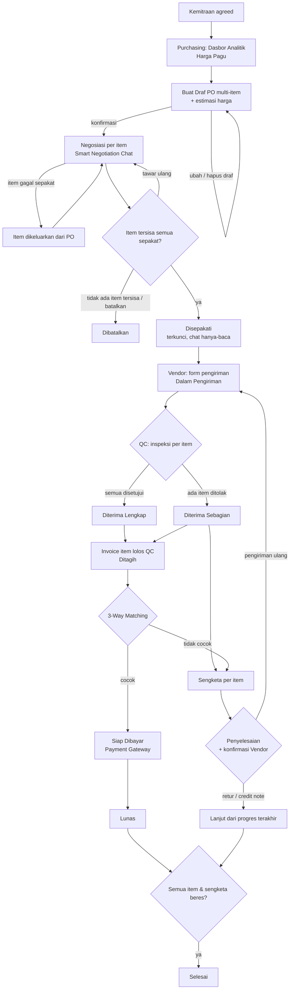
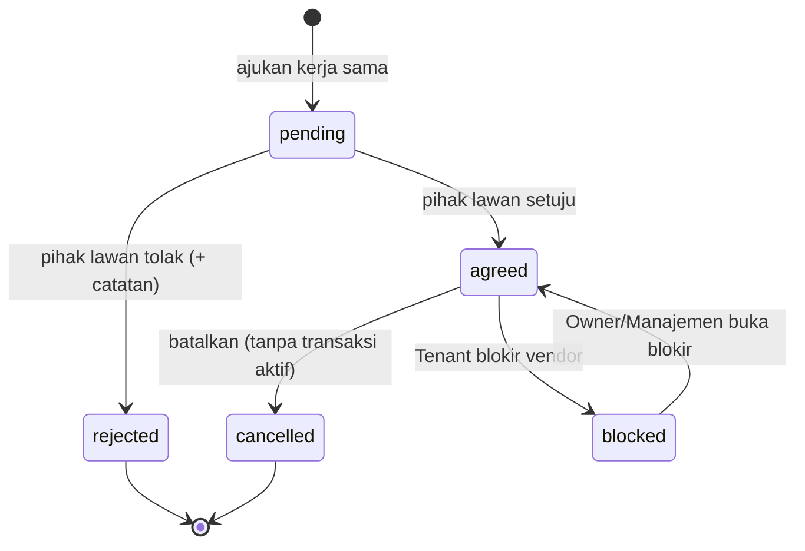
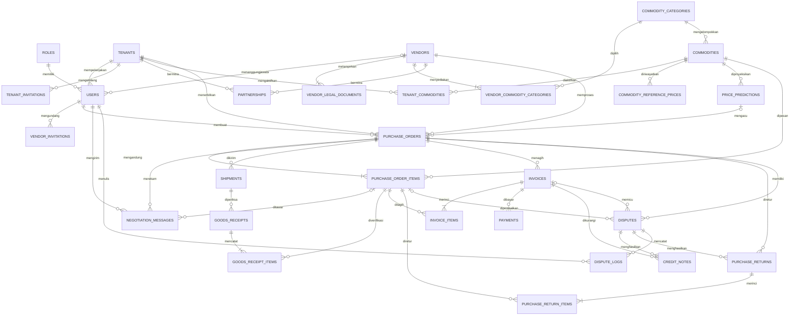
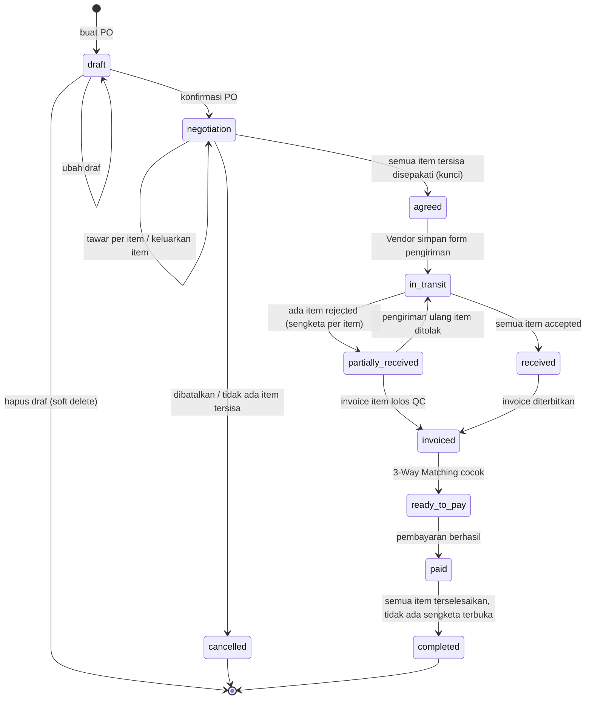
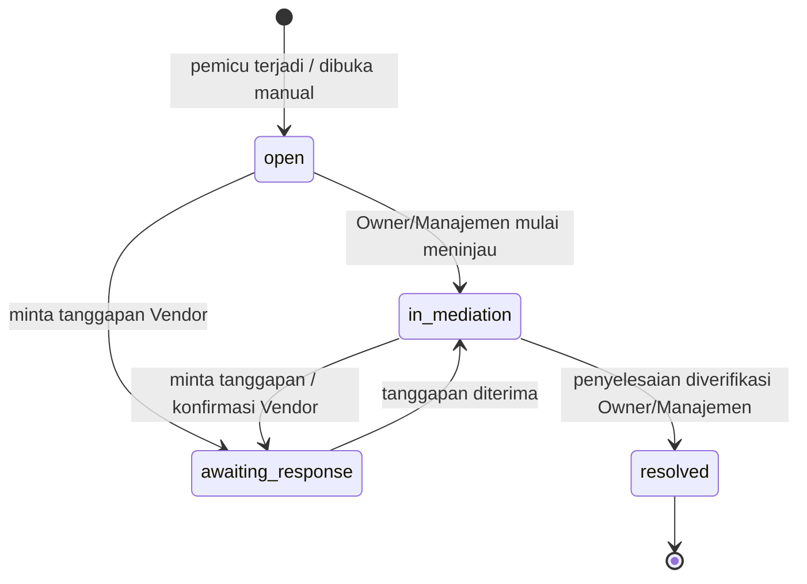

# PAGORA — Product Requirements Document (PRD)

> Dokumen konteks untuk developer & AI coding agent. Diperbarui 30 Oktober 2026 (rev. 5: keputusan tim tahap 1–4).
> **Sumber**: `SKPL_Pagora_Baru.docx` (SKPL v1.1, 24 Okt 2026), `PAGORA DIAGRAM (UML).drawio.xml`
> (TO-BE, BPMN, Use Case, Activity per aktor, `ERD_saas(verBaru)`, `Class Diagram saas (verBaru)`), dan **keputusan tim 30 Okt 2026** (§10.2).
> Halaman `ERD_1Tenant(verLama)` dan `Class Diagram 1 Tenant (verLama)` **sudah usang**.
> Detail skema (tipe kolom, nama saat ini → target, strategi migrasi, seeder): **`design-db.md`**; bila bertentangan, **PRD ini yang berlaku**. Standar kode: **`RULES.md`**.
>
> Penanda asal: **[SKPL]**, **[UML]**, **[Keputusan]** (keputusan tim yang menimpa/menambah SKPL), **[Kode]** (sudah ada di repo).
> ⚠️ = masih terbuka, lihat §10.3. **[Usulan]** = turunan PRD dari keputusan tim, dikonfirmasi saat implementasi.
>
> **Konvensi bahasa** [Keputusan Q-15, Q-26]: seluruh **nama tabel, kolom, dan enum di database berbahasa Inggris**
> (pengecualian: nilai role `manajemen` & `qc_gudang` tetap seperti sekarang [Keputusan Q-27]);
> seluruh **teks antarmuka berbahasa Indonesia**. Dokumen ini memakai nama aktor/fitur Indonesia untuk prosa dan `kode` Inggris untuk skema.

---

## 1. Ringkasan Proyek

**PAGORA** adalah aplikasi web portal **e-procurement B2B multi-tenant** untuk pengadaan bahan baku industri.
Satu instansi aplikasi melayani banyak **perusahaan pembeli (Tenant)** dan **pemasok (Vendor)** dengan data terisolasi,
dikelola secara global oleh **Superadmin** platform.

| Masalah | Solusi PAGORA |
|---|---|
| Harga tidak transparan, rawan *mark-up*, negosiasi "buta" | Rekomendasi **Harga Pagu** (batas harga wajar tertinggi) via **Regresi Linier** dari data **API Harga Pangan Bank Indonesia** |
| Dokumen tercecer (chat, kertas), salah catat penerimaan | Seluruh dokumen (PO, chat, pengiriman, penerimaan, invoice, credit note, pembayaran) terpusat |
| Pembayaran tanpa validasi, risiko kelebihan bayar | **3-Way Matching** otomatis (PO ↔ Penerimaan Gudang ↔ Invoice) sebelum pelunasan via **Payment Gateway** |
| Sengketa tanpa bukti | **Sengketa** dengan siklus hidup sendiri + **Log Sengketa** permanen (riwayat chat + foto bukti QC) |

**Target pengguna**: Superadmin platform; perusahaan pembeli (Owner, Manajemen, Purchasing/Finance, QC Gudang); perusahaan pemasok (Vendor).

## 2. Tujuan & Ruang Lingkup

### 2.1 Tujuan
1. Mendigitalisasi siklus pengadaan end-to-end: kemitraan → PO → negosiasi → logistik → inspeksi → invoice → verifikasi → pelunasan.
2. Memberi Purchasing acuan harga wajar (DSS) sebelum dan selama negosiasi.
3. Mencegah pembayaran yang tidak sesuai dengan barang yang benar-benar diterima.
4. Menyediakan jejak audit permanen untuk mediasi sengketa.

### 2.2 Dalam Cakupan
- Registrasi Tenant & Vendor, undangan vendor & staf via email, login (email/password atau Google), Ingat Saya, Lupa Kata Sandi, update akun, logout.
- Verifikasi Tenant & legalitas Vendor serta blokir global oleh Superadmin.
- Manajemen profil perusahaan & anggota internal (Owner).
- Master komoditas & kategori **global** (Superadmin) + aktivasi komoditas & toleransi susut per Tenant.
- Kemitraan B2B dua arah, termasuk blokir vendor per Tenant.
- Dasbor analitik tren harga + Harga Pagu.
- Purchase Order multi-item dengan estimasi harga + negosiasi **per item**, self-reporting logistics, inspeksi QC per item, invoice untuk item lolos QC, 3-Way Matching, pembayaran (sandbox).
- Sengketa (siklus hidup, pembukaan otomatis & manual, penyelesaian: pengiriman ulang / retur / credit note, konfirmasi Vendor, Log Sengketa, ekspor).
- Pencarian & filter pada setiap tabel data.

### 2.3 Di Luar Cakupan (Out of Scope)
- Aplikasi mobile native (Android/iOS); hanya web responsif.
- Integrasi API pelacakan resi/kurir; status logistik murni input manual Vendor.
- Pembayaran produksi (hanya **sandbox** Midtrans/Xendit selama proyek).
- Prediksi harga untuk komoditas yang tidak tersedia di API Bank Indonesia.
- **Fitur langganan/paket Tenant** (Free, Basic, Professional, Enterprise); kolom paket tidak dibuat.
- Hard delete data transaksi oleh siapa pun.

## 3. Aktor & Hak Akses

Semua aktor terautentikasi adalah spesialisasi dari aktor abstrak **User** (mewarisi Login, Update Akun, Lupa Kata Sandi, Logout).
Seluruh aktivitas selain registrasi, konfirmasi undangan, dan reset kata sandi wajib login.

| Aktor (label UI) | `roles.name` | Kode saat ini | Pihak | Boleh | Tidak boleh |
|---|---|---|---|---|---|
| **Guest** | — | — | Publik | Registrasi Tenant, Registrasi Vendor (mandiri / via undangan), Menerima Ajakan Perusahaan, Lupa Kata Sandi | Semua fitur lain |
| **Superadmin** | `superadmin` | `superadmin` | Platform | Verifikasi Tenant & legalitas Vendor, kelola master komoditas & kategori global, blokir/aktifkan vendor **global**, kelola platform | Bertindak sebagai Tenant dalam transaksi |
| **Owner** | `owner` | `owner` | Tenant | Manajemen Perusahaan, Manajemen Anggota Perusahaan, **seluruh aktivitas internal Tenant** (REQ-TEN-03), menetapkan sengketa Selesai | Memberi role `superadmin`; aktivitas Vendor |
| **Manajemen** (Admin) | `manajemen` | `manajemen` | Tenant | Aktivasi komoditas & atur toleransi susut Tenant, kelola kerja sama, undang vendor, blokir/buka blokir vendor **per Tenant**, buka, tinjau & tetapkan sengketa Selesai | Ubah PO / invoice |
| **Purchasing / Finance** | `purchasing` [Keputusan Q-22] | `buyer` | Tenant | Pantau Harga Pagu, kelola PO + negosiasi, verifikasi tagihan (3-Way Matching), pelunasan, buka sengketa | Isi pengiriman, inspeksi gudang, terbitkan invoice, menetapkan sengketa Selesai |
| **QC Gudang** | `qc_gudang` | `qc_gudang` | Tenant | Inspeksi barang per item, terima / tolak + unggah foto bukti | Ubah PO / invoice |
| **Vendor** | `vendor` | `vendor` | Eksternal | Kelola kerja sama, tanggapi PO + negosiasi per item (**tanpa melihat Harga Pagu**), self-reporting logistics, terbitkan invoice, menanggapi & **mengonfirmasi** penyelesaian sengketa | Halaman internal Tenant, PO milik pihak lain, Harga Pagu, membuka sengketa manual, mengubah status sengketa |

- **Role pegawai yang bisa diberikan Owner**: Manajemen, Purchasing/Finance, QC Gudang. `superadmin` tidak boleh diberikan Owner [Keputusan Q-06].
- "Finance" **bukan role terpisah**; tugas finance (verifikasi tagihan & pembayaran) dijalankan role `purchasing` [Keputusan Q-22].
- **Isolasi data (NFR-02)**: Vendor tidak dapat membuka halaman internal Tenant dan sebaliknya; user hanya mengakses PO yang terkait dengannya; data antar-Tenant terisolasi. Superadmin dapat melihat lintas Tenant untuk pengelolaan platform.

## 4. Daftar Use Case

| ID | Use Case | Aktor | FR terkait |
|---|---|---|---|
| UC-01 | Registrasi Akun Tenant | Guest | FR-01 |
| UC-02 | Registrasi Akun Vendor | Guest | FR-02 |
| UC-03 | Menerima Ajakan Perusahaan | Guest | FR-03 |
| UC-04 | Login | User | FR-04 |
| UC-05 | Update Akun | User | FR-05 |
| UC-06 | Logout | User | FR-06 |
| UC-07 | Manajemen Perusahaan | Owner | FR-08, FR-10 |
| UC-08 | Manajemen Anggota Perusahaan | Owner | FR-09, FR-10, FR-07 |
| UC-09 | Mengelola Data Komoditas | Superadmin (master global); Manajemen, Owner (aktivasi per Tenant) | FR-11, FR-35, FR-07 |
| UC-10 | Mengelola Kerja Sama | Manajemen, Vendor, Owner | FR-12, FR-13, FR-14, FR-07 |
| UC-11 | Pantau Tren Harga dan Rekomendasi Harga Pagu | Purchasing, Owner | FR-15, FR-16 |
| UC-12 | Mengelola Purchase Order (PO) | Purchasing, Owner | FR-17, FR-18, FR-19, FR-21 |
| UC-13 | Menanggapi Pesanan (PO) Masuk | Vendor | FR-19, FR-20, FR-21 |
| UC-14 | Melaporkan Status Logistik Fisik via Form | Vendor | FR-22, FR-23 |
| UC-15 | Melakukan Inspeksi Barang (+ «extend» Melaporkan kerusakan barang) | QC Gudang, Owner | FR-24, FR-25, FR-26 |
| UC-16 | Menerbitkan Tagihan Digital (Invoice) | Vendor | FR-27 |
| UC-17 | Memverifikasi Kelayakan Tagihan & Pembayaran | Purchasing, Owner | FR-28, FR-29, FR-30, FR-39, FR-07 |
| UC-18 | Mengelola Sengketa (Meninjau Kendala Pengadaan) | Owner, Manajemen, Purchasing; Vendor (menanggapi & konfirmasi) | FR-31, FR-38, FR-40, FR-41, FR-42, FR-07 |
| UC-19 | Melakukan Pemblokiran Vendor | Manajemen, Owner (per Tenant); Superadmin (global) | FR-32, FR-37 |
| UC-20 | Mengundang Vendor Baru **[baru]** | Manajemen, Owner | FR-34 |
| UC-21 | Verifikasi Akun Tenant & Vendor **[baru]** | Superadmin | FR-36 |
| UC-22 | Lupa Kata Sandi **[baru]** | Guest / User | FR-33 |

> UC-13 s.d. UC-19 tidak memiliki spesifikasi tertulis di SKPL; alurnya **diturunkan dari activity diagram [UML]** lalu disesuaikan dengan keputusan tim.
> UC-20 s.d. UC-22 berasal dari keputusan tim dan **belum ada di SKPL/UML**.
> Pola **Search & Filter** yang berulang (klik search/filter → input kata kunci/filter → sistem menjalankan kueri → tampilkan hasil, atau tabel kosong dengan pesan "data tidak ditemukan") disebut **[SF]**.

### UC-01 Registrasi Akun Tenant
- **Aktor**: Guest (calon Owner). **Prasyarat**: belum login / belum punya akun.
- **Alur utama**:
  1. Guest membuka halaman daftar tenant; sistem memuat form halaman 1 (**Form Owner**).
  2. Guest mengisi nama, email, kata sandi lalu konfirmasi lanjut.
  3. Sistem menyimpan data di *state* dan memuat halaman 2 (**Form Perusahaan**).
  4. Guest mengisi nama perusahaan, NPWP, alamat, dan mengunggah dokumen legalitas (NPWP / Surat Izin Usaha).
  5. Guest mengonfirmasi pendaftaran; sistem memvalidasi kelengkapan data & berkas.
  6. Sistem menyimpan profil ke `users` (role `owner`) dan perusahaan ke `tenants` dengan status **menunggu verifikasi**.
  7. Sistem menampilkan "Pendaftaran sukses".
- **Alternatif/error**: 5a. Data tidak valid (kolom wajib kosong, email terdaftar, berkas > 5 MB / format salah) → tolak, tampilkan error di kolom terkait, tetap di form.
- **Hasil**: data Owner & Tenant tersimpan; Tenant aktif setelah diverifikasi Superadmin (UC-21).

### UC-02 Registrasi Akun Vendor
- **Aktor**: Guest (calon Vendor), mandiri **atau** lewat tautan undangan (UC-20). **Prasyarat**: belum login / belum punya akun.
- **Alur utama**:
  1. Guest membuka halaman daftar vendor (bila dari undangan, data awal terisi dari undangan); sistem memuat form halaman 1 (**Form Profil**).
  2. Guest mengisi nama, email, kata sandi lalu konfirmasi lanjut.
  3. Sistem menyimpan data di *state* dan memuat halaman 2 (**Form Perusahaan**).
  4. Guest mengisi nama perusahaan, **NPWP**, email perusahaan, telepon, alamat, memilih **satu atau lebih kategori komoditas**, dan mengunggah dokumen legalitas (NPWP / Surat Izin Usaha).
  5. Guest mengonfirmasi; sistem memvalidasi kelengkapan data & berkas.
  6. Sistem menyimpan ke `users` (role `vendor`), `vendors`, `vendor_commodity_categories`, dan `vendor_legal_documents` (status **pending**).
  7. Sistem menampilkan "Pendaftaran sukses".
- **Alternatif/error**: 5a. Data tidak valid (kolom kosong, format email/NPWP salah, kategori belum dipilih, berkas tidak sesuai / > 5 MB) → tolak, tampilkan error, tetap di form. 1a. Tautan undangan kedaluwarsa / tidak valid → pesan error.
- **Hasil**: data Vendor tersimpan; legalitas diverifikasi Superadmin (UC-21).

### UC-03 Menerima Ajakan Perusahaan
- **Aktor**: Guest (calon staf internal Tenant). **Prasyarat**: Owner telah mengirim undangan; Guest punya akses ke inbox email.
- **Alur utama**:
  1. Guest membuka email undangan dari Owner.
  2. Guest menekan konfirmasi persetujuan undangan.
  3. Sistem menampilkan halaman login PAGORA (bila belum punya akun → diarahkan ke registrasi terlebih dahulu).
  4. Guest login (alur UC-04).
  5. Sistem menampilkan antarmuka beserta detail perusahaan yang mengundang.
- **Alternatif/error**: 2a. Guest menolak undangan → tidak diproses, Guest tidak terhubung ke perusahaan.
- **Hasil**: akun terhubung ke Tenant dengan role yang ditetapkan Owner.
- **Catatan**: undangan email (UC-03) dan akun langsung + password default (UC-08) **keduanya dipakai** [Keputusan Q-04].

### UC-04 Login
- **Aktor**: User. **Prasyarat**: akun aktif, belum dalam sesi.
- **Alur utama**:
  1. User membuka halaman Login; sistem memuat form.
  2. User memasukkan email + kata sandi (opsional centang **Ingat Saya**) **atau** memilih login dengan Google.
  3. Sistem memverifikasi akun dan status aktif (user, Tenant/Vendor terkait).
  4. Sistem membuat sesi login.
  5. Sistem mengarahkan ke dashboard sesuai role.
- **Alternatif/error**: 3a. Kredensial salah → "Username atau password salah"; akun / vendor diblokir global / belum terverifikasi → "Akun ditangguhkan". User tetap di form login.
- **Hasil**: sesi terbentuk, user di dashboard sesuai role.

### UC-05 Update Akun
- **Aktor**: User. **Prasyarat**: sudah login.
- **Alur utama**:
  1. User klik profil akun di bagian bawah sidebar → "Pengaturan" → "Profil".
  2. Sistem memuat detail profil.
  3. User klik "Edit profil", mengubah Username / Email / Password, lalu konfirmasi.
  4. Sistem memvalidasi dan menyimpan ke `users`.
  5. Sistem menampilkan notifikasi sukses.
- **Alternatif/error**: 4a. Tidak valid (email dipakai user lain, konfirmasi password tidak cocok) → gagal, tidak disimpan, form dimuat ulang.
- **Hasil**: profil diperbarui.

### UC-06 Logout
- **Aktor**: User. **Prasyarat**: sesi aktif.
- **Alur utama**:
  1. User klik profil akun di sidebar → "Logout".
  2. Sistem menghapus sesi di server.
  3. Sistem kembali ke halaman login dengan pesan sukses.
- **Alternatif/error**: 2a. Gagal hapus sesi → "Logout gagal", tetap di halaman sistem.
- **Hasil**: sesi berakhir.

### UC-07 Manajemen Perusahaan
- **Aktor**: Owner. **Prasyarat**: login.
- **Alur utama**:
  1. Owner membuka menu "Manajemen Perusahaan"; sistem memuat detail perusahaan.
  2. Owner klik "Ubah profil perusahaan", mengubah Nama / NPWP / Alamat, lalu "Simpan perubahan".
  3. Sistem memvalidasi dan memperbarui `tenants`.
  4. Sistem menampilkan "Edit data sukses".
- **Alternatif/error**: 3a. Tidak valid (NPWP salah format, kolom kosong) → batal, detail dimuat ulang.
- **Hasil**: profil Tenant diperbarui.

### UC-08 Manajemen Anggota Perusahaan
- **Aktor**: Owner. **Prasyarat**: login.
- **Alur utama (Tambah Pegawai)**:
  1. Owner membuka "Manajemen Perusahaan" → submenu "Kelola Internal Perusahaan"; sistem memuat daftar pegawai.
  2. Owner memilih "Tambah"; sistem memuat form.
  3. Owner mengisi Nama, Email, Role (Manajemen / Purchasing-Finance / QC Gudang), lalu simpan.
  4. Sistem memvalidasi, membuat akun dengan **password default**.
  5. Sistem mengirim password default + notifikasi ke email pegawai.
- **Alur alternatif**:
  - **Cari/Filter** [SF] berdasarkan Role / Status.
  - **Ubah**: pilih pegawai → detail → "Edit pegawai" (Nama, Email, Password, Role) → simpan → validasi → update `users` → notifikasi sukses.
  - **Hapus**: pilih pegawai → detail → hapus → konfirmasi → **soft delete** → notifikasi sukses.
- **Error**: form tidak lengkap / email terdaftar / role tidak diizinkan → error, batal simpan; ubah/hapus gagal → pesan "perubahan tidak sesuai" / "akun gagal dihapus".
- **Hasil**: data pegawai diperbarui; akun baru menerima email kredensial.

### UC-09 Mengelola Data Komoditas
Master komoditas & kategori bersifat **global** dan dikelola Superadmin; setiap Tenant **mengaktifkan** komoditas yang dipakai dan dapat mengatur **toleransi susut** sendiri [Keputusan Q-07, Q-07b].
- **Aktor**: Superadmin (master global); Manajemen, Owner (aktivasi per Tenant). **Prasyarat**: login.
- **Alur utama A — Kelola master (Superadmin)**:
  1. Kelola **kategori komoditas** (tambah / ubah / nonaktifkan) di `commodity_categories`.
  2. Buka menu "Komoditas"; sistem memuat daftar; cari/filter [SF] berdasarkan Kategori / Status.
  3. **Tambah**: isi Nama, Kategori, Satuan, Toleransi susut default, Kode referensi API → simpan → validasi → notifikasi sukses.
  4. **Ubah**: pilih → detail → edit → simpan → validasi → notifikasi.
  5. **Hapus**: pilih → hapus → konfirmasi → **soft delete** → notifikasi.
- **Alur utama B — Aktivasi per Tenant (Manajemen/Owner)**:
  1. Buka menu "Komoditas"; sistem memuat katalog global beserta status aktif & toleransi susut Tenant ini; cari/filter [SF].
  2. Aktifkan / nonaktifkan komoditas, dan opsional ubah toleransi susut khusus Tenant → sistem menyimpan ke `tenant_commodities`.
- **Error**: form tidak lengkap / nama duplikat / toleransi susut di luar 0–100% → error, kembali ke form; ubah/hapus gagal → info gagal, detail dimuat ulang.
- **Hasil**: master global & konfigurasi komoditas Tenant diperbarui. Hanya komoditas aktif di Tenant yang bisa dipilih di PO.

### UC-10 Mengelola Kerja Sama
- **Aktor**: Manajemen (+ Owner) dari sisi Tenant, **atau** Vendor. Alur simetris. **Prasyarat**: login; kedua perusahaan terdaftar & terverifikasi.
- **Alur utama (Ajukan Kerja Sama Baru)**:
  1. Buka menu "Kelola Kerja Sama"; sistem memuat daftar mitra yang sudah bekerja sama.
  2. Pilih "Ajukan kerja sama baru"; sistem memuat daftar perusahaan yang **belum** bekerja sama.
  3. Cari/filter [SF] (lokasi / kategori komoditas), pilih perusahaan target; sistem memuat profilnya.
  4. Tekan "Ajukan kerja sama".
  5. Sistem menyimpan `partnerships` berstatus `pending` (Menunggu) dan menampilkan "Pengajuan kerja sama dalam Validasi mitra".
- **Alur alternatif (Terima / Tolak undangan)**:
  1. Buka tab "Undangan Kerja Sama Masuk"; sistem memuat daftar pengaju; cari/filter [SF]; pilih undangan; sistem memuat detail.
  2. **Terima** → `agreed` (Disepakati), notifikasi sukses ke pengaju (email/inbox).
  3. **Tolak** → konfirmasi penolakan + catatan alasan → `rejected` (Ditolak), `rejection_reason` terisi.
- **Alur alternatif (Batalkan Kerja Sama)**:
  1. Dari daftar mitra aktif, cari/filter [SF] → pilih → detail → "Batalkan hubungan" → konfirmasi pop-up.
  2. Sistem **cek transaksi aktif**; jika tidak ada → `cancelled` (Dibatalkan), notifikasi sukses.
- **Error**: pengajuan gagal (koneksi/server) → batal simpan, pesan gagal; pembatalan saat masih ada PO belum selesai atau sengketa terbuka → ditolak: "Tidak dapat membatalkan kerja sama karena masih terdapat transaksi aktif".
- **Hasil**: status kemitraan diperbarui.

### UC-11 Pantau Tren Harga dan Rekomendasi Harga Pagu
- **Aktor**: Purchasing, Owner. **Prasyarat**: login; API BI tersedia **atau** ada data historis lokal.
- **Alur utama**:
  1. Buka menu "Dashboard Analitik".
  2. Sistem me-request riwayat harga komoditas dari API Harga Pangan Bank Indonesia.
  3. Sistem menghitung tren periode mendatang dengan Regresi Linier.
  4. Sistem menampilkan grafik prediksi + angka rekomendasi **Harga Pagu**.
  5. Purchasing meninjau grafik sebagai referensi.
- **Alternatif/error**:
  - 2a. API BI tidak dapat diakses → pakai data historis terakhir di DB lokal dan tampilkan "Data harga terbaru tidak dapat diambil. Menampilkan data terakhir per {tanggal waktu}."
  - 3a. Data historis tidak cukup / perhitungan gagal → error dicatat ke log; tampilkan "Prediksi harga untuk komoditas ini belum dapat dihitung."
  - 2b. Tidak ada data API maupun lokal → tampilkan "Data harga untuk komoditas ini belum tersedia."
- **Hasil**: grafik tren & Harga Pagu tampil.

### UC-12 Mengelola Purchase Order (PO)
- **Aktor**: Purchasing, Owner. **Prasyarat**: login; ada Vendor dengan kemitraan `agreed` dan tidak diblokir; komoditas aktif untuk Tenant [Keputusan Q-12].
- **Alur utama (Buat Draf & Negosiasi Sepakat)**:
  1. Buka menu "Purchase Order" → "Buat Purchase Order baru"; sistem menampilkan form (daftar vendor hanya berisi mitra `agreed` & tidak diblokir).
  2. Pilih Vendor, lalu tambahkan **satu atau lebih item**: komoditas, kuantitas, dan **estimasi harga satuan** (referensi anggaran; Harga Pagu ditampilkan sebagai acuan). Sistem menampilkan estimasi total.
  3. Kirim; sistem menyimpan PO berstatus `draft` dan memunculkan pop-up konfirmasi PO.
  4. Purchasing memilih lanjut negosiasi dan mengonfirmasi PO.
  5. Sistem mengubah status → `negotiation`, mengaktifkan Smart Negotiation Chat, menyiapkan opsi rekomendasi harga (hanya terlihat oleh pihak Tenant).
  6. Purchasing mengajukan harga **per item** di chat → Vendor menanggapi per item (UC-13).
  7. Bila Vendor mengajukan harga baru untuk suatu item, Purchasing mengevaluasi; Purchasing menyetujui.
  8. Ketika **semua item yang tersisa** telah disepakati, sistem menyimpan harga final per item (`unit_price`, `subtotal`) dan status → `agreed`.
  9. Sistem **mengunci** dokumen PO beserta harga dan menjadikan chat **hanya-baca**.
- **Alternatif (Item gagal disepakati)** [Keputusan Q-24]: 7a. Purchasing tidak setuju dan tidak mengajukan ulang harga untuk suatu item → item tsb **dikeluarkan dari PO** (`negotiation_status = removed`); item lain tetap dinegosiasikan. Bila **tidak ada item tersisa**, PO tidak dapat diteruskan → status `cancelled`.
- **Alternatif (Batalkan PO)**: 7b. Purchasing menekan "Batalkan Purchase Order" selama belum `agreed` → status `cancelled`.
- **Alternatif (Ubah Draf)**: 4a. Tidak lanjut negosiasi → "Update Draf PO?" → "Ubah Draf" → ubah Vendor / item (komoditas, kuantitas, estimasi harga) → konfirmasi → simpan → kembali ke pop-up langkah 3.
- **Alternatif (Hapus Draf)**: 4b. Pada "Update Draf PO?" pilih "Hapus Draf" → konfirmasi → **soft delete**.
- **Error**: 2a. Form tidak lengkap (tidak ada item, komoditas tidak dipilih, kuantitas ≤ 0, estimasi harga kosong) → error validasi, tetap di form. 1a. Tidak ada vendor mitra aktif → pesan agar menjalin kerja sama terlebih dahulu.
- **Hasil**: PO berstatus `draft` / `negotiation` / `agreed` (terkunci) / `cancelled` / terhapus (soft).

### UC-13 Menanggapi Pesanan (PO) Masuk  [UML]
- **Aktor**: Vendor. **Prasyarat**: PO berstatus `negotiation` dan Purchasing telah mengajukan harga.
- **Alur utama**:
  1. Vendor meninjau pesanan dan harga yang diajukan Purchasing **per item** di Smart Negotiation Chat. **Harga Pagu dan estimasi harga internal tidak ditampilkan kepada Vendor** [Keputusan Q-13; menimpa REQ-PO-04 & BPMN].
  2. **Setujui harga** item → item `agreed`; bila semua item tersisa `agreed` → UC-12 langkah 8–9.
- **Alternatif**: 2a. **Ajukan harga baru** untuk item tsb (`vendor_offer_price`, item `countered`) → diteruskan ke Purchasing. Berulang hingga sepakat, item dikeluarkan, atau PO dibatalkan.
- **Hasil**: harga item disepakati atau negosiasi berlanjut.

### UC-14 Melaporkan Status Logistik Fisik via Form  [UML]
- **Aktor**: Vendor. **Prasyarat**: PO berstatus `agreed`, atau `partially_received` untuk pengiriman ulang item ditolak.
- **Alur utama**:
  1. Vendor membuka menu "Pengiriman" → formulir "Pengiriman".
  2. Vendor mengisi jalur pengiriman, nama armada ekspedisi, nomor plat armada, perkiraan tanggal tiba (ETA), lalu simpan.
  3. Sistem menyimpan `shipments` dan mengubah status PO menjadi `in_transit` (Dalam Pengiriman).
  4. Sistem **mengunci mutlak** detail (kuantitas) PO.
- **Hasil**: pengiriman tercatat; PO Dalam Pengiriman dan terkunci.

### UC-15 Melakukan Inspeksi Barang  [UML]
Inspeksi dan penolakan berlaku **per item (baris PO)**, bukan seluruh PO [Keputusan Q-10].
- **Aktor**: QC Gudang, Owner. **Prasyarat**: PO berstatus `in_transit`; armada tiba di pabrik.
- **Alur utama**:
  1. QC membuka menu "Pengecekan"; sistem memuat daftar pesanan.
  2. QC memilih pesanan berstatus Dalam Pengiriman; sistem memuat detail beserta daftar item.
  3. QC membuat Form Pengecekan Barang dan, **untuk setiap item**, memeriksa kondisi fisik serta mencatat jumlah diterima.
  4. Item sesuai → status item `accepted` (Disetujui).
  5. QC menyimpan form; sistem menyimpan `goods_receipts` + `goods_receipt_items`.
  6. Semua item disetujui → status PO `received` (Diterima Lengkap).
- **Alternatif (Melaporkan kerusakan barang, «extend»)**: 4a. Item tidak sesuai → status item `rejected` (Ditolak) → isi catatan → unggah **≥ 1 foto bukti** (≤ 5 MB) → sistem membuka **sengketa** untuk item tsb dan mencatat ke Log Sengketa. Item lain tetap diproses; status PO `partially_received` (Diterima Sebagian); PO tidak dibatalkan.
- **Hasil**: penerimaan tercatat per item.

### UC-16 Menerbitkan Tagihan Digital (Invoice)  [UML]
Invoice **hanya untuk item yang lolos QC** [Keputusan Q-10b].
- **Aktor**: Vendor. **Prasyarat**: PO berstatus `received` atau `partially_received`, dan ada item `accepted` yang belum ditagih.
- **Alur utama**:
  1. Vendor membuka menu "Pengiriman"; sistem memuat daftar; cari/filter [SF] (status / rentang tanggal); pilih item.
  2. Sistem memuat detail dan mengecek status penerimaan di QC Gudang.
  3. Ada item `accepted` yang belum ditagih → tombol penerbitan tagihan **ditampilkan**.
  4. Vendor klik tombol penerbitan; sistem menyusun **preview** invoice dari item tsb (kuantitas diterima × harga final).
  5. Vendor mengecek preview dan mengonfirmasi.
  6. Sistem menyimpan `invoices` + `invoice_items`, status PO → `invoiced` (Ditagih), dan meneruskannya ke perusahaan pembeli terkait.
- **Alternatif**: 3a. Tidak ada item `accepted` yang belum ditagih → tombol **disembunyikan**, alur selesai.
- **Hasil**: invoice tersimpan dan diterima Purchasing. Satu PO dapat memiliki lebih dari satu invoice (mis. setelah pengiriman ulang).

### UC-17 Memverifikasi Kelayakan Tagihan & Pembayaran  [UML]
- **Aktor**: Purchasing/Finance, Owner. **Prasyarat**: invoice telah diterbitkan Vendor.
- **Alur utama**:
  1. Buka menu verifikasi tagihan (atau notifikasi); sistem memuat daftar tagihan milik perusahaan; cari/filter [SF] (status / rentang tanggal).
  2. Pilih invoice; sistem memuat detail (termasuk credit note yang berlaku).
  3. Tekan "eksekusi validasi"; sistem mengambil 3 referensi **per item**: kuantitas & harga final PO, kuantitas diterima Gudang, kuantitas & nominal Invoice.
  4. Sistem mengeksekusi 3-Way Matching → **cocok** → `invoices.matching_status = matched`.
  5. Status PO → `ready_to_pay` (Siap Dibayar); sistem membuat `payments` (`pending`) sebesar tagihan dikurangi credit note yang `confirmed`, lalu menyalurkan ke Payment Gateway (API).
  6. Purchasing memproses pelunasan; callback gateway memperbarui `payments` (`reference_number`, `payment_status`, `payment_date`, `proof_file`).
  7. Semua invoice PO lunas → status PO `paid` (Lunas).
- **Alternatif**: 4a. **Tidak cocok** (jumlah barang ≠ invoice, atau nilai tagihan ≠ kesepakatan) → `matching_status = mismatched`, pembayaran ditolak, sistem membuka **sengketa** + Log Sengketa; status PO tidak berubah tetapi PO **dibekukan** selama sengketa terbuka. 6a. Pembayaran gagal → `payment_status = failed`, Purchasing dapat mencoba lagi.
- **Hasil**: invoice lunas atau sengketa terbuka.

### UC-18 Mengelola Sengketa (Meninjau Kendala Pengadaan)  [UML + Keputusan]
- **Aktor**: Owner, Manajemen (tinjau & tetapkan Selesai); Purchasing (buka & tinjau); Vendor (menanggapi & mengonfirmasi). **Prasyarat**: login.
- **Alur utama (tinjau & selesaikan)**:
  1. Buka menu "Sengketa"; sistem memuat daftar `disputes`; cari/filter [SF] (status / pemicu / rentang tanggal).
  2. Pilih sengketa; sistem memuat detail lengkap (pemicu, PO & item terkait, riwayat Smart Negotiation Chat, foto bukti QC, Log Sengketa, credit note & retur terkait).
  3. Owner/Manajemen meninjau, meminta tanggapan atau bukti dari Vendor bila perlu (`awaiting_response`), lalu memediasi (`in_mediation`); setiap langkah tercatat di Log Sengketa.
  4. Saat sepakat, Owner/Manajemen memilih **jenis penyelesaian**: pengiriman ulang, retur, atau potongan tagihan (credit note), dan mengisi catatan.
  5. Bila penyelesaian membutuhkan tindakan Vendor (pengiriman ulang, persetujuan credit note, retur), sistem meminta **konfirmasi Vendor**; Vendor mengonfirmasi (`vendor_confirmed_at`) [Keputusan Q-25, Q-28]. Untuk retur, sistem membuat dokumen `purchase_returns` yang dikonfirmasi Vendor.
  6. Owner/Manajemen **memverifikasi** penyelesaian dan menetapkan status `resolved` (Selesai).
  7. Sistem membuka kembali PO dan menetapkan statusnya **berdasarkan progres terakhir** (§9.1), lalu menjalankan tindak lanjut (pengiriman ulang / pengurangan tagihan / retur).
  8. Tekan "unduh sengketa"; sistem mengekspor dokumen sengketa.
- **Alur alternatif (buka manual)**: 1a. Owner / Manajemen / Purchasing membuka sengketa manual pada PO (mis. tidak sepakat penyelesaian transaksi) dengan alasan & bukti → status `open`.
- **Alur alternatif (Vendor menolak penyelesaian)**: 5a. Vendor tidak mengonfirmasi → sengketa kembali `in_mediation`.
- **Hasil**: sengketa terselesaikan; Vendor tidak pernah mengubah status menjadi `resolved` secara langsung; riwayat tersimpan permanen.

### UC-19 Melakukan Pemblokiran Vendor  [UML + Keputusan]
- **Aktor**: Manajemen, Owner (**per Tenant**); Superadmin (**global**). **Prasyarat**: login.
- **Alur utama (per Tenant)**:
  1. Buka menu "Manajemen Akun" → "Kelola Vendor"; sistem memuat daftar vendor mitra Tenant; cari/filter [SF].
  2. Pilih vendor; sistem memuat detail.
  3. Tekan "Blokir", isi alasan, konfirmasi dialog.
  4. Sistem mengubah kemitraan menjadi `blocked` (Diblokir). PO yang sedang berjalan **tetap diselesaikan**; pembuatan PO baru dengan vendor tsb **ditolak** sampai blokir dibuka [Keputusan Q-14b].
- **Alur alternatif (global, Superadmin)**: 3a. Superadmin memblokir vendor secara global → `vendors.is_active = false`, hak akses dicabut, seluruh sesi akun vendor diputus, alasan & waktu blokir dicatat (`block_reason`, `blocked_by`, `blocked_at`).
- **Alternatif (Buka blokir)**: Owner atau Manajemen membuka blokir per Tenant; Superadmin membuka blokir global [Kode: `VendorService` aktifkan kembali].
- **Hasil**: vendor terblokir per Tenant atau global; riwayat transaksi utuh.

### UC-20 Mengundang Vendor Baru  [Keputusan + Kode]
- **Aktor**: Manajemen, Owner. **Prasyarat**: login.
- **Alur utama**:
  1. Buka menu vendor → "Undang Vendor"; isi email vendor (dan data awal: nama perusahaan, kategori komoditas, pesan).
  2. Sistem menyimpan `vendor_invitations` (token unik, masa berlaku) dan mengirim email berisi **tautan registrasi**.
  3. Vendor membuka tautan → melengkapi profil & dokumen legalitas (UC-02).
  4. Superadmin memverifikasi vendor (UC-21).
- **Alternatif/error**: 1a. Email sudah terdaftar sebagai vendor → tolak dengan pesan. 3a. Tautan kedaluwarsa → pesan error.
- **Hasil**: undangan tercatat, vendor terdaftar setelah registrasi.

### UC-21 Verifikasi Akun Tenant & Vendor  [Keputusan]
- **Aktor**: Superadmin. **Prasyarat**: login; ada registrasi Tenant atau dokumen legalitas Vendor berstatus `pending`.
- **Alur utama**:
  1. Buka menu verifikasi; sistem memuat daftar Tenant/Vendor menunggu verifikasi; cari/filter [SF].
  2. Pilih entri; sistem memuat detail dan dokumen legalitas (dapat diunduh).
  3. **Setujui** → status `approved`/aktif, catat verifikator & waktu, kirim notifikasi email.
- **Alternatif**: 3a. **Tolak** + alasan → `rejected`, notifikasi email berisi alasan.
- **Hasil**: Tenant/Vendor aktif dan dapat login, atau ditolak.

### UC-22 Lupa Kata Sandi  [Keputusan]
- **Aktor**: Guest / User yang lupa kata sandi.
- **Alur utama**:
  1. Klik "Lupa Kata Sandi" di halaman Login, masukkan email.
  2. Sistem mengirim email berisi **tautan reset** dengan token berlaku **60 menit**.
  3. User membuka tautan, memasukkan kata sandi baru + konfirmasi.
  4. Sistem memvalidasi token & kata sandi, menyimpan hash baru, menampilkan pesan sukses dan mengarahkan ke Login.
- **Alternatif/error**: 4a. Token kedaluwarsa / tidak valid → pesan error, minta tautan baru. 1a. Email tidak terdaftar → tampilkan pesan generik yang sama dengan sukses.
- **Hasil**: kata sandi diperbarui.

## 5. Alur Sistem Utama

### 5.1 Siklus Pengadaan End-to-End

1. **Onboarding**: Tenant & Vendor registrasi (vendor bisa via undangan) → diverifikasi Superadmin.
2. **Kemitraan**: Tenant dan Vendor menjalin kemitraan hingga `agreed` (UC-10). Syarat wajib sebelum PO.
3. **Riset harga**: Purchasing membuka Dasbor Analitik → API BI → Regresi Linier → Harga Pagu (UC-11).
4. **Draf PO**: PO multi-item dengan estimasi harga (`draft`); dapat diubah/dihapus selama belum dikonfirmasi (UC-12).
5. **Negosiasi per item**: `negotiation`; tiap item ditawar hingga disepakati atau dikeluarkan (Vendor tidak melihat Harga Pagu).
   - Semua item tersisa sepakat → `agreed`, dokumen & harga **terkunci**, chat **hanya-baca**.
   - Tidak ada item tersisa / dibatalkan → `cancelled`.
6. **Logistik**: Vendor isi form pengiriman → `in_transit`, kuantitas terkunci mutlak (UC-14).
7. **Inspeksi per item**: semua disetujui → `received`; ada yang ditolak → `partially_received` + sengketa per item (UC-15).
8. **Invoice**: Vendor menerbitkan invoice **hanya untuk item lolos QC** → `invoiced` (UC-16).
9. **Verifikasi & bayar**: 3-Way Matching (UC-17).
   - Cocok → `ready_to_pay` → Payment Gateway → `payments` → `paid`.
   - Tidak cocok → sengketa dibuka, PO dibekukan (status PO tetap).
10. **Sengketa**: ditinjau Owner/Manajemen, diselesaikan via pengiriman ulang / retur / credit note (dengan konfirmasi Vendor bila perlu); PO dilanjutkan dari progres terakhir (UC-18).
11. **Selesai**: semua item terselesaikan, semua invoice lunas, tidak ada sengketa terbuka → `completed`.

### 5.2 Siklus Kerja Sama

## 6. Kebutuhan Fungsional

Prioritas: **Must** = Tinggi di SKPL / wajib menurut keputusan tim, **Should** = Sedang.

| ID | Kebutuhan | Aktor | Prioritas | UC | Ref |
|---|---|---|---|---|---|
| FR-01 | Registrasi Tenant bertahap: data Owner → profil perusahaan (nama, NPWP, alamat) + unggah legalitas; status menunggu verifikasi | Guest | Must | UC-01 | REQ-AUTH-01 |
| FR-02 | Registrasi Vendor bertahap (mandiri / via undangan): data individu → profil perusahaan (nama, NPWP, alamat, kontak, **≥ 1 kategori komoditas**) + wajib unggah legalitas | Guest | Must | UC-02 | REQ-AUTH-02 |
| FR-03 | Email undangan bergabung ke Tenant; konfirmasi via tautan (ke login / registrasi bila belum punya akun) | Guest, Owner | Must | UC-03 | REQ-AUTH-03 |
| FR-04 | Login email + kata sandi atau Google; opsi **Ingat Saya**; validasi status aktif; buat sesi; redirect sesuai role | User | Must | UC-04 | REQ-AUTH-04 |
| FR-05 | Lihat & perbarui profil akun pribadi (username, email, password) | User | Should | UC-05 | REQ-AUTH-05 |
| FR-06 | Logout aman, kembali ke halaman Login | User | Must | UC-06 | REQ-AUTH-06 |
| FR-07 | Search kata kunci + filter (status / rentang tanggal / kategori / role) di setiap tabel data | User | Must | banyak UC | REQ-GEN-01 |
| FR-08 | Owner melihat & mengubah profil Tenant (nama, NPWP, alamat) | Owner | Must | UC-07 | REQ-TEN-01 |
| FR-09 | Owner mengelola pegawai: tambah (Manajemen / Purchasing-Finance / QC Gudang, password default via email), ubah, nonaktifkan (soft delete) | Owner | Must | UC-08 | REQ-TEN-02 |
| FR-10 | Owner memiliki akses penuh ke seluruh aktivitas internal Tenant | Owner | Must | UC internal | REQ-TEN-03 |
| FR-11 | CRUD **kategori komoditas** & master komoditas **global** (nama, kategori, satuan, toleransi susut default, kode referensi API, status); hapus = soft delete | Superadmin | Must | UC-09 | REQ-PART-01 (diubah) |
| FR-12 | Lihat daftar mitra & ajukan kerja sama B2B ke pihak lawan | Manajemen, Vendor, Owner | Must | UC-10 | REQ-PART-02 |
| FR-13 | Tinjau undangan kerja sama masuk; setujui (+ notifikasi) atau tolak (+ catatan) | Manajemen, Vendor, Owner | Must | UC-10 | REQ-PART-03 |
| FR-14 | Batalkan kerja sama; ditolak bila masih ada PO belum selesai atau sengketa terbuka | Manajemen, Vendor, Owner | Must | UC-10 | REQ-PART-04 |
| FR-15 | Tarik riwayat harga dari API Harga Pangan BI dan hitung proyeksi dengan Regresi Linier | Sistem | Must | UC-11 | REQ-PRC-01 |
| FR-16 | Tampilkan grafik prediksi & Harga Pagu di Dasbor Analitik; fallback data lokal + waktu pembaruan bila API down | Purchasing, Owner | Must | UC-11 | REQ-PRC-02 |
| FR-17 | Buat draf PO **multi-item** (komoditas, kuantitas, **estimasi harga satuan**) hanya ke vendor mitra `agreed` & tidak diblokir; tampilkan estimasi total | Purchasing, Owner | Must | UC-12 | REQ-PO-01 |
| FR-18 | Ubah draf PO atau hapus (soft delete) selama `draft`; batalkan selama belum `agreed` | Purchasing, Owner | Must | UC-12 | REQ-PO-02 |
| FR-19 | Smart Negotiation Chat terikat ke satu PO; tawar-menawar **per item** berulang; panduan Harga Pagu **hanya untuk pihak Tenant**; item yang gagal disepakati dikeluarkan dari PO | Purchasing, Vendor, Owner | Must | UC-12, UC-13 | REQ-PO-03 (diubah) |
| FR-20 | Vendor meninjau PO masuk & harga yang diajukan per item; setujui atau ajukan harga baru; **Harga Pagu & estimasi internal tidak ditampilkan** | Vendor | Must | UC-13 | REQ-PO-04 (diubah) |
| FR-21 | Saat semua item tersisa sepakat: status `agreed`, kunci PO + harga final per item, chat hanya-baca; tanpa item tersisa → `cancelled` | Sistem | Must | UC-12, UC-13 | REQ-PO-05 |
| FR-22 | Form Self-Reporting Logistics: jalur pengiriman, nama/no. plat armada, ETA (untuk PO `agreed` atau pengiriman ulang) | Vendor | Must | UC-14 | REQ-LOG-01 |
| FR-23 | Setelah form logistik disimpan: status `in_transit` & kunci mutlak kuantitas PO | Sistem | Must | UC-14 | REQ-LOG-02 |
| FR-24 | Form Goods Receipt per item untuk PO `in_transit`: cek fisik, catat jumlah diterima | QC Gudang, Owner | Must | UC-15 | REQ-QC-01 |
| FR-25 | Konfirmasi item `accepted`; semua `accepted` → PO `received` | QC Gudang, Owner | Must | UC-15 | REQ-QC-02 |
| FR-26 | Tolak item: wajib catatan + ≥ 1 foto bukti; buka sengketa untuk item tsb; PO → `partially_received`, **tidak dibatalkan** | QC Gudang, Owner | Must | UC-15 | REQ-QC-03 (diubah) |
| FR-27 | Terbitkan invoice + preview **hanya untuk item lolos QC** yang belum ditagih; tombol disembunyikan bila tidak ada | Vendor | Must | UC-16 | REQ-INV-01 (diubah) |
| FR-28 | Verifikasi tagihan dengan 3-Way Matching otomatis per item (PO, penerimaan QC, invoice) | Purchasing, Owner | Must | UC-17 | REQ-INV-02 |
| FR-29 | Cocok → `ready_to_pay` → Payment Gateway → pembayaran tercatat → `paid` | Purchasing, Owner | Must | UC-17 | REQ-INV-03 |
| FR-30 | Tidak cocok → tolak pembayaran, buka sengketa + Log Sengketa, PO dibekukan (status PO tidak diubah) | Sistem | Must | UC-17 | REQ-INV-04 (diubah) |
| FR-31 | Halaman Sengketa: daftar + detail (pemicu, item, riwayat chat, foto QC, Log Sengketa immutable, credit note) + unduh/ekspor | Owner, Manajemen, Purchasing | Must | UC-18 | REQ-GOV-01 |
| FR-32 | Blokir vendor **per Tenant** (alasan wajib); PO berjalan tetap diselesaikan; PO baru ditolak; buka blokir oleh Owner/Manajemen | Manajemen, Owner | Must | UC-19 | REQ-GOV-02 (diubah) |
| FR-33 | Lupa Kata Sandi via tautan reset email, token berlaku 60 menit | Guest/User | Must | UC-22 | Baru |
| FR-34 | Undang vendor baru via email (tautan registrasi bertoken & bermasa berlaku) | Manajemen, Owner | Must | UC-20 | Baru (usulan isi REQ-PART-05) |
| FR-35 | Tenant mengaktifkan/menonaktifkan komoditas global dan mengatur toleransi susut sendiri; PO hanya memakai komoditas aktif | Manajemen, Owner | Must | UC-09 | Baru |
| FR-36 | Verifikasi registrasi Tenant & legalitas Vendor (setujui / tolak + alasan, notifikasi email) | Superadmin | Must | UC-21 | Baru |
| FR-37 | Blokir vendor **global** (cabut akses, putus semua sesi) & aktifkan kembali | Superadmin | Must | UC-19 | REQ-GOV-02 (diubah) |
| FR-38 | Sengketa memiliki siklus hidup & status sendiri (terpisah dari PO); dibuka otomatis atau manual (Owner/Manajemen/Purchasing); ditetapkan `resolved` hanya oleh Owner/Manajemen setelah verifikasi; PO lanjut dari progres terakhir | Owner, Manajemen, Purchasing | Must | UC-18 | Baru |
| FR-39 | Catat pembayaran di `payments` (1 invoice : N pembayaran) beserta status & bukti dari Payment Gateway | Sistem, Purchasing | Must | UC-17 | Baru |
| FR-40 | Penyelesaian sengketa: pengiriman ulang, retur, atau credit note, dengan **konfirmasi Vendor** bila butuh tindakan Vendor | Owner, Manajemen, Vendor | Must | UC-18 | Baru |
| FR-41 | Kelola **credit note** sebagai dokumen tersendiri (nomor, tanggal, nominal, alasan, referensi invoice & sengketa); satu sengketa dapat menghasilkan > 1 credit note; mengurangi tagihan setelah dikonfirmasi Vendor | Owner, Manajemen, Vendor | Must | UC-18, UC-17 | Baru |
| FR-42 | Kelola **retur** sebagai dokumen tersendiri (`purchase_returns` + item): nomor, tanggal, item & kuantitas diretur, alasan, referensi PO & sengketa; wajib **dikonfirmasi Vendor**; item diretur tidak ditagih | Owner, Manajemen, Vendor | Must | UC-18 | Baru |

## 7. Kebutuhan Non-Fungsional

| ID | Kategori | Kebutuhan | Ref SKPL |
|---|---|---|---|
| NFR-01 | Keamanan | Login email + kata sandi (atau Google); kata sandi di-hash (bcrypt/argon2) | NFR-SEC-01 |
| NFR-02 | Keamanan | RBAC + isolasi data multi-tenant di sisi server; Vendor ↔ internal Tenant terpisah; user hanya akses PO terkait; Harga Pagu & estimasi harga tidak pernah dikirim ke Vendor (termasuk payload API/Inertia props) | NFR-SEC-02 |
| NFR-03 | Keamanan | Semua halaman/endpoint selain Login, Registrasi, Konfirmasi Undangan, Reset Kata Sandi, dan callback Payment Gateway wajib login. **Sesi kedaluwarsa setelah 30 menit tidak aktif**; **Ingat Saya maksimal 30 hari**; sesi diputus paksa saat akun diblokir | NFR-SEC-03 + Keputusan |
| NFR-04 | Keamanan | Validasi input di server; proteksi SQL Injection, XSS, CSRF; callback Payment Gateway diverifikasi tanda tangannya | NFR-SEC-04 |
| NFR-05 | Keamanan | Unggahan (NPWP/SIUP, foto QC, bukti pembayaran, bukti sengketa) dibatasi format & ukuran (≤ 5 MB/berkas); disimpan di lokasi non-eksekusi | NFR-SEC-05 |
| NFR-06 | Keamanan | Kredensial API BI & Payment Gateway di `.env`; token undangan & reset kata sandi acak, sekali pakai, bermasa berlaku | NFR-SEC-06 + Keputusan |
| NFR-07 | Reliabilitas | Chat negosiasi, foto inspeksi, harga PO terkunci, Log Sengketa, riwayat sengketa, serta credit note & retur yang dikonfirmasi permanen: tidak bisa diubah / hard delete oleh siapa pun (termasuk Superadmin) | NFR-REL-01 |
| NFR-08 | Reliabilitas | Availability ≥ 99% pada Senin–Sabtu 07.00–18.00 WIB; backup DB otomatis ≥ 1×/hari; maintenance di luar jam operasional | NFR-REL-02 |
| NFR-09 | Reliabilitas | API BI down → dasbor tetap jalan dengan data lokal terakhir + waktu pembaruan terakhir | NFR-REL-03 |
| NFR-10 | Kinerja | Muat halaman standar ≤ 3 dtk; login & simpan form ≤ 2 dtk | NFR-PERF-01 |
| NFR-11 | Kinerja | 3-Way Matching & Regresi Linier + grafik ≤ 5 dtk | NFR-PERF-02 |
| NFR-12 | Kinerja | Pesan chat tampil di lawan bicara ≤ 5 dtk (polling atau WebSocket); unggah foto dengan progress indicator | NFR-PERF-03 |
| NFR-13 | Usability | Sidebar sesuai role; responsif desktop/tablet/smartphone; halaman QC ramah sentuh dengan tombol besar | NFR-UI-01 |
| NFR-14 | Usability | Dialog konfirmasi untuk aksi kritikal (batalkan PO, keluarkan item, kunci kesepakatan, tolak barang, blokir akun, selesaikan sengketa); error validasi di dekat kolom | NFR-UI-02 |
| NFR-15 | Usability | Seluruh teks UI, label status & role, pesan validasi, dan dokumen keluaran berbahasa Indonesia secara konsisten; WIB; Rupiah (IDR) | NFR-UI-03 |
| NFR-16 | Kompatibilitas | Chrome, Firefox, Edge, Safari versi terbaru via HTTPS; pertukaran data JSON | NFR-COMP-01 |
| NFR-17 | Maintainability | Monolit Laravel + React Vite + PostgreSQL. **Nama tabel, kolom, dan enum berbahasa Inggris** (nilai role `manajemen`/`qc_gudang` dikecualikan); label UI Indonesia lewat `label()` pada PHP Backed Enum | NFR-MAIN-01 + Keputusan Q-26, Q-27 |

## 8. Model Data

Sumber: `ERD_saas(verBaru)` + `Class Diagram saas (verBaru)`, diterjemahkan ke Bahasa Inggris [Keputusan Q-26] dan ditambah perubahan keputusan tim.
Nama tabel & kolom di bawah adalah **target**; migration saat ini masih memakai nama ERD Indonesia (lihat §8.3).
Semua tabel memakai `id` (PK) + `uuid` (UK) + `created_at`/`updated_at` kecuali tabel log immutable (hanya `created_at`).

### 8.1 Entitas
| Tabel | Kolom penting |
|---|---|
| `roles` | `name` (`superadmin`, `owner`, `manajemen`, `purchasing`, `qc_gudang`, `vendor`), `description` |
| `users` | `name`, `email` (UK), `password`, `role_id`, `tenant_id` (nullable), `vendor_id` (nullable), `is_active`, `google_id`, `remember_token`, `deleted_at` |
| `tenants` | `company_name`, `tax_number` (NPWP), `legal_document_path`, `address`, `verification_status` (`pending`/`approved`/`rejected`), `is_active`, `verified_by`, `verified_at` |
| `vendors` | `slug` (UK), `company_name`, `tax_number` (NPWP), `contact_email` (UK), `phone`, `address`, `verification_status`, `is_active` (blokir **global**), `block_reason`, `blocked_by`, `blocked_at` |
| `vendor_commodity_categories` | `vendor_id`, `commodity_category_id` (M:N) |
| `vendor_legal_documents` | `vendor_id`, `document_type`, `document_number`, `file_path`, `verification_status`, `rejection_reason`, `verified_by` (Superadmin), `verified_at` |
| `vendor_invitations` | `email`, `company_name`, `commodity_category_id` (nullable), `message`, `token` (UK), `status` (`pending`/`accepted`/`expired`/`cancelled`), `invited_by`, `expires_at`, `registered_at` |
| `tenant_invitations` | `tenant_id`, `email`, `role_id` (`manajemen`/`purchasing`/`qc_gudang`), `token` (UK), `status` (`pending`/`accepted`/`declined`/`expired`), `invited_by` (Owner), `expires_at`, `responded_at` |
| `partnerships` | `tenant_id`, `vendor_id`, `status` (`pending`/`agreed`/`rejected`/`cancelled`/`blocked`), `rejection_reason`, `block_reason`, `blocked_by`, `blocked_at` |
| `commodity_categories` | `name` (UK), `description`, `is_active` |
| `commodities` | `slug` (UK), `name` (UK), `commodity_category_id`, `unit`, `default_shrinkage_tolerance`, `api_reference_code`, `is_active`, `deleted_at` |
| `tenant_commodities` | `tenant_id`, `commodity_id`, `is_active`, `shrinkage_tolerance` (nullable = pakai default) |
| `commodity_reference_prices` | `commodity_id`, `date`, `price`, `source` |
| `price_predictions` | `commodity_id`, `prediction_date`, `predicted_price`, `recommended_ceiling_price` (Harga Pagu), `calculated_at` |
| `purchase_orders` | `po_number` (UK), `tenant_id`, `vendor_id`, `created_by`, `price_prediction_id`, `ceiling_price_reference`, `status` (§9.1), `po_date`, `notes`, `deleted_at` |
| `purchase_order_items` | `purchase_order_id`, `commodity_id`, `quantity`, `estimated_unit_price`, `vendor_offer_price`, `unit_price` (final), `subtotal`, `negotiation_status` |
| `negotiation_messages` | `purchase_order_id`, `purchase_order_item_id` (nullable), `sender_id`, `message`, `offer_amount`, `created_at` (immutable) |
| `shipments` | `purchase_order_id`, `route`, `carrier_name`, `vehicle_plate_number`, `estimated_arrival_date`, `status`, `reported_by` |
| `goods_receipts` | `purchase_order_id`, `shipment_id`, `inspected_by`, `matched_plate_number`, `inspected_at`, `notes` |
| `goods_receipt_items` | `goods_receipt_id`, `purchase_order_item_id`, `received_quantity`, `status` (`accepted`/`rejected`), `notes`, `rejection_photos` (json, immutable) |
| `invoices` | `purchase_order_id` (1 PO : N invoice), `vendor_id`, `vendor_invoice_number` (unik per vendor), `total_amount`, `file_path`, `invoice_date`, `matching_status` (`pending`/`matched`/`mismatched`), `verified_by`, `verified_at` |
| `invoice_items` | `invoice_id`, `purchase_order_item_id`, `quantity`, `unit_price`, `subtotal` |
| `payments` | `invoice_id` (1 invoice : N payments), `payment_number` (UK), `payment_date`, `amount`, `payment_method`, `payment_status` (`pending`/`paid`/`failed`), `reference_number`, `proof_file`, `created_by` |
| `credit_notes` | `credit_note_number` (UK), `invoice_id`, `dispute_id`, `credit_date`, `amount`, `reason`, `status` (`draft`/`awaiting_vendor_confirmation`/`confirmed`/`rejected`) [Usulan], `vendor_confirmed_by`, `vendor_confirmed_at`, `created_by` |
| `purchase_returns` [Keputusan Q-28] | `return_number` (UK), `purchase_order_id`, `dispute_id`, `return_date`, `reason`, `status` (`draft`/`awaiting_vendor_confirmation`/`confirmed`/`rejected`/`completed`) [Usulan], `vendor_confirmed_by`, `vendor_confirmed_at`, `created_by` |
| `purchase_return_items` [Usulan] | `purchase_return_id`, `purchase_order_item_id`, `goods_receipt_item_id`, `quantity`, `notes` |
| `disputes` | `purchase_order_id`, `invoice_id` (nullable), `purchase_order_item_id` (nullable), `trigger_type`, `opened_by`, `status` (§9.3), `resolution_type` (`reshipment`/`return`/`credit_note`), `resolution_notes`, `vendor_confirmed_by`, `vendor_confirmed_at`, `resolved_by`, `opened_at`, `resolved_at` |
| `dispute_logs` | `dispute_id`, `user_id`, `message`, `attachment_path`, `created_at` (immutable) |

### 8.2 Relasi

FK ke `users` lainnya: `tenants.verified_by`, `vendors.blocked_by`, `vendor_legal_documents.verified_by`, `partnerships.blocked_by`,
`shipments.reported_by`, `goods_receipts.inspected_by`, `invoices.verified_by`, `payments.created_by`,
`credit_notes.created_by`, `credit_notes.vendor_confirmed_by`, `purchase_returns.created_by`, `purchase_returns.vendor_confirmed_by`, `disputes.opened_by`, `disputes.vendor_confirmed_by`, `disputes.resolved_by`.

### 8.3 Pemetaan Nama Lama → Baru
Nama lama = ERD `ERD_saas(verBaru)` / migration saat ini. Dipakai saat refactor; kolom yang tidak disebut diterjemahkan langsung.

| Lama (ERD / kode) | Baru |
|---|---|
| `role.nama_role`, `deskripsi` | `roles.name`, `description` |
| role `buyer` | `purchasing` (`manajemen` & `qc_gudang` tetap) |
| `user.nama_lengkap`, `perusahaan_id`, `status_aktif` | `users.name`, `tenant_id`, `is_active` |
| `perusahaan_PURCHASING` (`perusahaan_buyer` di kode), `nomor_npwp`, `file_url`, `tipe_paket` | `tenants`, `tax_number`, `legal_document_path`, (dihapus) |
| `vendor.nama_perusahaan`, `email_kontak`, `no_telepon`, `alamat`, `status_aktif`, `alasan_pemblokiran`, `diblokir_pada`, `kategori_komoditas` | `vendors.company_name`, `contact_email`, `phone`, `address`, `is_active`, `block_reason`, `blocked_at`, → `vendor_commodity_categories` |
| `dokumen_legalitas_vendor` (`jenis_dokumen`, `nomor_dokumen`, `file_url`, `verif_by`, `diverifikasi_pada`) | `vendor_legal_documents` (`document_type`, `document_number`, `file_path`, `verified_by`, `verified_at`) |
| `undangan_vendor` | `vendor_invitations` |
| `KerjaSama` / `kerja_sama` (`id_perusahaan`, `id_vendor`, `status_kerjasama`, `catatan_penolakan`) | `partnerships` (`tenant_id`, `vendor_id`, `status`, `rejection_reason`) |
| `komoditas` (`nama_komoditas`, `satuan`, `batas_susut`, `kode_referensi_api`, `kategori`) | `commodities` (`name`, `unit`, `default_shrinkage_tolerance`, `api_reference_code`, `commodity_category_id`) |
| — | `commodity_categories`, `tenant_commodities` |
| `harga_referensi_komoditas` (`tanggal`, `harga`, `sumber_data`) | `commodity_reference_prices` (`date`, `price`, `source`) |
| `prediksi_harga` (`tanggal_prediksi`, `harga_prediksi`, `harga_pagu_rekomendasi`, `dihitung_pada`) | `price_predictions` (`prediction_date`, `predicted_price`, `recommended_ceiling_price`, `calculated_at`) |
| `purchase_order` (`nomor_po`, `perusahaan_PURCHASING_id`, `harga_pagu_acuan`, `tanggal_po`, `catatan`) | `purchase_orders` (`po_number`, `tenant_id`, `ceiling_price_reference`, `po_date`, `notes`) |
| `po_item` (`jumlah_pesanan`, `harga_satuan_po`, `harga_tawar_vendor`, `status_item`) | `purchase_order_items` (`quantity`, `unit_price`, `vendor_offer_price`, `negotiation_status`) + `estimated_unit_price` |
| `chat_negosiasi` (`pengirim_id`, `pesan_teks`, `nominal_tawar`) | `negotiation_messages` (`sender_id`, `message`, `offer_amount`) + `purchase_order_item_id` |
| `pengiriman` (`jalur_pengiriman`, `nama_armada_ekspedisi`, `no_polisi_armada`, `perkiraan_tanggal_tiba`, `dilaporkan_oleh`) | `shipments` (`route`, `carrier_name`, `vehicle_plate_number`, `estimated_arrival_date`, `reported_by`) |
| `penerimaan_barang` (`check_by`, `no_polisi_dicocokkan`, `tanggal_pemeriksaan`, `catatan`) | `goods_receipts` (`inspected_by`, `matched_plate_number`, `inspected_at`, `notes`) + `shipment_id` |
| `penerimaan_barang_item` (`jumlah_diterima`, `foto_bukti_penolakan`) | `goods_receipt_items` (`received_quantity`, `rejection_photos`) |
| `invoice` (`nomor_invoice_vendor`, `jumlah_tagihan`, `file_invoice`, `tanggal_invoice`, `status_matching`, `diverifikasi_oleh`) | `invoices` (`vendor_invoice_number`, `total_amount`, `file_path`, `invoice_date`, `matching_status`, `verified_by`) |
| — | `invoice_items`, `payments`, `credit_notes`, `purchase_returns`, `purchase_return_items` |
| `sengketa` (`dibuka_oleh`, `tanggal_dibuka`, `tanggal_selesai`) | `disputes` (`opened_by`, `opened_at`, `resolved_at`) + kolom baru §8.1 |
| `log_sengketa` (`isi_pesan`, `file_bukti`) | `dispute_logs` (`message`, `attachment_path`) |

## 9. Aturan Bisnis & Validasi

### 9.1 Status Purchase Order
Enum DB/kode **berbahasa Inggris**, label UI **berbahasa Indonesia** [Keputusan Q-15]. **Status PO hanya mencerminkan progres transaksi; sengketa punya status sendiri** (§9.3). PO dengan sengketa terbuka dianggap **dibekukan**: transisi yang terdampak sengketa (pembayaran invoice/item terkait, `completed`) diblokir sampai sengketa `resolved`.

| Enum | Label UI | Kode saat ini |
|---|---|---|
| `draft` | Draft | `draft` |
| `negotiation` | Negosiasi | `negosiasi` |
| `agreed` | Disepakati | `disepakati` |
| `in_transit` | Dalam Pengiriman | `dalam_pengiriman` |
| `partially_received` | Diterima Sebagian | — |
| `received` | Diterima Lengkap | `diterima_gudang` |
| `invoiced` | Ditagih | `ditagih` |
| `ready_to_pay` | Siap Dibayar | — |
| `paid` | Lunas | `lunas` |
| `completed` | Selesai | — |
| `cancelled` | Dibatalkan | `dibatalkan` |

Dihapus dari enum PO: `menunggu_tanggapan` dan `sengketa` [Keputusan Q-15].

**Kembali dari sengketa**: setelah sengketa `resolved`, PO dilanjutkan dari **progres terakhirnya** (mis. tetap `invoiced` lalu diverifikasi ulang dengan credit note; atau ke `in_transit` bila penyelesaiannya pengiriman ulang), bukan kembali ke status awal [Keputusan Q-16].

**Status lain**
| Objek | Enum → Label UI |
|---|---|
| Kemitraan (`partnerships.status`) | `pending` Menunggu, `agreed` Disepakati, `rejected` Ditolak, `cancelled` Dibatalkan, `blocked` Diblokir |
| Negosiasi item (`purchase_order_items.negotiation_status`) | `pending` Menunggu, `countered` Ditawar Ulang, `agreed` Disepakati, `removed` Dikeluarkan |
| Item penerimaan (`goods_receipt_items.status`) | `accepted` Disetujui, `rejected` Ditolak |
| Invoice (`invoices.matching_status`) | `pending` Menunggu Verifikasi, `matched` Sesuai, `mismatched` Tidak Sesuai |
| Pembayaran (`payments.payment_status`) | `pending` Menunggu Pembayaran, `paid` Berhasil, `failed` Gagal |
| Credit note (`credit_notes.status`) [Usulan] | `draft` Draf, `awaiting_vendor_confirmation` Menunggu Konfirmasi Vendor, `confirmed` Dikonfirmasi, `rejected` Ditolak |
| Retur (`purchase_returns.status`) [Usulan] | `draft` Draf, `awaiting_vendor_confirmation` Menunggu Konfirmasi Vendor, `confirmed` Dikonfirmasi, `rejected` Ditolak, `completed` Selesai (barang sudah dikembalikan) |
| Verifikasi (`tenants`, `vendors`, `vendor_legal_documents`) | `pending` Menunggu Verifikasi, `approved` Disetujui, `rejected` Ditolak |

### 9.2 Aturan Wajib (Invariants)
| ID | Aturan |
|---|---|
| BR-01 | Harga Pagu hanya **pendukung keputusan (DSS)**; sistem tidak memaksa harga, keputusan di Purchasing. |
| BR-02 | Harga Pagu & estimasi harga **hanya terlihat oleh pihak Tenant**; tidak pernah ditampilkan atau dikirim ke Vendor. |
| BR-03 | PO hanya dapat dibuat ke vendor dengan kemitraan `agreed` (tidak `blocked`/`cancelled`) dan vendor tidak diblokir global. |
| BR-04 | PO hanya bisa diubah/dihapus saat `draft`; setelah `agreed`, dokumen & harga **terkunci**. |
| BR-05 | Estimasi harga hanya referensi anggaran; harga final per item ditentukan dari hasil negosiasi. |
| BR-06 | Item yang gagal disepakati **dikeluarkan** (`removed`), bukan membatalkan PO; PO `agreed` bila semua item tersisa `agreed`; tanpa item tersisa → `cancelled`. |
| BR-07 | Setelah form pengiriman disimpan, detail kuantitas PO **terkunci mutlak**. |
| BR-08 | Smart Negotiation Chat **terikat ke satu PO**; menjadi **hanya-baca** saat PO `agreed`; riwayat permanen. |
| BR-09 | Form pengiriman hanya untuk PO `agreed` atau pengiriman ulang item ditolak; inspeksi QC hanya untuk PO `in_transit`. |
| BR-10 | Inspeksi & penolakan **per item**. Item `rejected` wajib **catatan** + **≥ 1 foto** (≤ 5 MB/berkas) dan membuka sengketa untuk item tsb; PO **tidak** dibatalkan. |
| BR-11 | Invoice **hanya untuk item lolos QC** yang belum ditagih; tombol disembunyikan bila tidak ada. |
| BR-12 | 3-Way Matching per item membandingkan kuantitas & harga final PO, kuantitas diterima Gudang, kuantitas & nominal Invoice; gagal → sengketa + Log Sengketa, pembayaran ditolak. |
| BR-13 | Payment Gateway hanya dibuka setelah 3-Way Matching **cocok** dan tidak ada sengketa terbuka atas invoice tsb. |
| BR-14 | Status PO dan status sengketa **terpisah**; sengketa terbuka membekukan PO; setelah `resolved` PO lanjut dari progres terakhir. |
| BR-15 | Sengketa hanya dapat ditetapkan `resolved` oleh **Owner atau Manajemen** setelah penyelesaian diverifikasi; bila penyelesaian butuh tindakan Vendor, wajib ada **konfirmasi Vendor** lebih dulu; Vendor tidak pernah mengubah status sengketa. |
| BR-16 | Credit note adalah dokumen tersendiri; mengurangi tagihan hanya setelah `confirmed` oleh Vendor; satu sengketa dapat menghasilkan lebih dari satu credit note; total credit note ≤ nilai invoice. |
| BR-17 | Chat negosiasi, foto inspeksi, PO terkunci, `dispute_logs`, sengketa `resolved`, serta credit note & retur `confirmed` **immutable**: tidak ada UPDATE / hard delete (kecuali transisi status retur `confirmed` → `completed`). |
| BR-18 | Hapus pegawai, komoditas, draf PO, dan blokir vendor = **soft delete / status**; riwayat transaksi tetap utuh. |
| BR-19 | Pembatalan kerja sama ditolak bila masih ada PO belum `completed`/`cancelled` atau sengketa terbuka. |
| BR-20 | Blokir **per Tenant**: PO berjalan tetap diselesaikan; PO baru ditolak sampai dibuka oleh Owner/Manajemen. Blokir **global** hanya oleh Superadmin dan memutus sesi. |
| BR-21 | Login ditolak bila user tidak aktif, Tenant/Vendor belum `approved`, atau vendor diblokir global. |
| BR-22 | Owner hanya dapat memberi role Manajemen, Purchasing/Finance, QC Gudang; tidak pernah `superadmin`. |
| BR-23 | PO hanya dapat memakai komoditas yang **aktif** untuk Tenant; toleransi susut memakai `tenant_commodities.shrinkage_tolerance` bila diisi, selain itu `commodities.default_shrinkage_tolerance`. |
| BR-24 | API BI down → tampilkan data historis lokal terakhir + waktu pembaruan. |
| BR-25 | Token reset kata sandi berlaku 60 menit & sekali pakai; sesi idle berakhir 30 menit; Ingat Saya maksimal 30 hari. |
| BR-26 | Satu invoice dapat memiliki banyak `payments`; invoice lunas bila total `payments` berstatus `paid` = `total_amount` − total credit note `confirmed`. |
| BR-27 | Retur adalah dokumen tersendiri (`purchase_returns`) dan wajib **dikonfirmasi Vendor**; kuantitas diretur ≤ kuantitas item yang ditolak QC; item diretur tidak boleh ditagih. |

### 9.3 Siklus Hidup Sengketa [Keputusan Q-16, Q-25]
Sengketa memiliki status sendiri, terpisah dari status PO. Riwayat sengketa & penyelesaiannya disimpan permanen.

**Pemicu** (`disputes.trigger_type`)
| Pemicu | Enum | Sumber | Dibuka |
|---|---|---|---|
| Barang diterima tidak sesuai pesanan | `goods_mismatch` | Inspeksi QC | Otomatis (item ditolak) |
| Hasil QC ditolak | `qc_rejected` | Inspeksi QC | Otomatis |
| Jumlah barang tidak sesuai invoice | `quantity_mismatch` | 3-Way Matching | Otomatis |
| Nilai tagihan berbeda dengan kesepakatan | `amount_mismatch` | 3-Way Matching | Otomatis |
| Vendor & pembeli tidak menyepakati penyelesaian transaksi | `settlement_disagreement` | Pengguna | Manual: Owner, Manajemen, Purchasing |

**Status** (`disputes.status`):

Label UI: `open` Terbuka, `awaiting_response` Menunggu Tanggapan, `in_mediation` Dalam Mediasi, `resolved` Selesai.
Ke `resolved` hanya oleh Owner/Manajemen; bila `resolution_type` membutuhkan tindakan Vendor, `vendor_confirmed_at` wajib terisi.

**Jenis penyelesaian** (`disputes.resolution_type`)
| Enum | Label UI | Butuh konfirmasi Vendor | Efek |
|---|---|---|---|
| `reshipment` | Pengiriman Ulang | Ya | Vendor mengirim ulang item ditolak → PO kembali `in_transit` → inspeksi ulang |
| `return` | Retur | Ya | Dibuat `purchase_returns` (+ item); setelah `confirmed` item ditolak dikembalikan ke vendor dan tidak ditagih |
| `credit_note` | Potongan Tagihan | Ya | Dibuat `credit_notes` (bisa > 1) yang mengurangi tagihan setelah `confirmed` |

### 9.4 Validasi Input
| Form | Aturan |
|---|---|
| Registrasi Tenant | Semua kolom wajib; email unik & valid; konfirmasi kata sandi cocok; NPWP format valid; dokumen legalitas wajib, format sesuai, ≤ 5 MB |
| Registrasi Vendor | Seperti Tenant + NPWP wajib & valid, minimal 1 kategori komoditas, email perusahaan & telepon valid |
| Profil perusahaan | Nama, NPWP (format valid), alamat wajib |
| Tambah pegawai | Nama, email (unik), role ∈ {Manajemen, Purchasing/Finance, QC Gudang} wajib |
| Update akun | Email unik terhadap user lain; konfirmasi password cocok |
| Undang vendor | Email wajib, format valid, belum terdaftar sebagai vendor |
| Lupa / reset kata sandi | Email format valid; token valid & belum kedaluwarsa; kata sandi baru + konfirmasi cocok |
| Kategori / komoditas master | Nama unik; kategori, satuan, toleransi susut (0–100%) wajib |
| Aktivasi komoditas Tenant | Toleransi susut override opsional, 0–100% |
| PO | Vendor mitra `agreed` & tidak diblokir; minimal 1 item; tiap item: komoditas aktif Tenant, kuantitas > 0, estimasi harga > 0 |
| Tawaran harga (chat) | Nominal > 0, terkait item yang `negotiation_status` ∈ {`pending`, `countered`} |
| Pengiriman | Jalur, nama armada, no. plat, ETA wajib |
| Inspeksi item ditolak | Catatan + ≥ 1 foto (≤ 5 MB) wajib |
| Sengketa manual | PO terkait, alasan wajib; bukti opsional (≤ 5 MB) |
| Penyelesaian sengketa | `resolution_type` wajib; konfirmasi Vendor wajib untuk tipe yang membutuhkan |
| Credit note | Nomor unik, tanggal, nominal > 0, alasan, invoice & sengketa terkait wajib; total ≤ nilai invoice |
| Retur | Nomor unik, tanggal, alasan, PO & sengketa terkait wajib; minimal 1 item; kuantitas > 0 dan ≤ kuantitas ditolak |
| Blokir vendor | Alasan wajib + dialog konfirmasi |

## 10. Asumsi, Keputusan, Pertanyaan Terbuka, dan Glosarium

### 10.1 Asumsi
- Semua pihak mematuhi SOP digital dan memiliki koneksi internet stabil; QC Gudang memakai tablet/smartphone berkamera.
- API BI stabil dengan format JSON konsisten.
- Owner menjalankan aktivitas internal dengan aturan yang sama seperti role aslinya.
- Komunikasi chat memakai polling berkala atau WebSocket (keduanya diizinkan SKPL).
- "Admin" / "Admin Tenant" dalam keputusan tim = Manajemen; "Finance" = Purchasing (satu role `purchasing`).

### 10.2 Keputusan Tim (30 Okt 2026)
| Q | Keputusan |
|---|---|
| Q-01 | Role `superadmin` tetap dipakai untuk mengelola platform secara global. |
| Q-02, Q-03 | Registrasi Tenant dan legalitas Vendor diverifikasi oleh **Superadmin**. |
| Q-04 | Penambahan staf memakai **keduanya**: undangan email (UC-03) dan akun langsung + password default (UC-08). |
| Q-05 | Undang vendor: Owner/Manajemen memasukkan email → tautan registrasi → vendor melengkapi profil & dokumen → verifikasi Superadmin. |
| Q-06 | Role pegawai mengikuti seeder: Owner memberi Manajemen, Purchasing, QC Gudang; tidak `superadmin`. |
| Q-07, Q-07b | Komoditas berkategori; master & kategori **global** dikelola **Superadmin** (tabel kategori terpisah); Tenant mengaktifkan komoditas & mengatur **toleransi susut** sendiri. |
| Q-08 | Registrasi Vendor memuat NPWP, kategori komoditas (vendor ↔ kategori **M:N**), data perusahaan, alamat, kontak, dokumen legalitas. |
| Q-09 | Sengketa memiliki FK ke PO (`disputes.purchase_order_id`). |
| Q-10, Q-10b | Penolakan QC **per item**; invoice **hanya untuk item lolos QC**; item ditolak ditindaklanjuti via **pengiriman ulang, retur, atau credit note**. |
| Q-11, Q-11b | PO **multi-item**; negosiasi **per item**; form PO menampilkan **estimasi harga** sebagai referensi anggaran. |
| Q-12 | PO wajib didahului kemitraan **`agreed`** yang masih aktif. |
| Q-13 | Vendor **tidak boleh** melihat Harga Pagu. |
| Q-14, Q-14b | Blokir vendor **per Tenant** (dibuka Owner/Manajemen; PO berjalan tetap diselesaikan; PO baru ditolak) + blokir **global** oleh Superadmin. |
| Q-15 | Enum DB berbahasa Inggris, label UI Indonesia; hapus `menunggu_tanggapan`; `awaiting_response` hanya untuk sengketa; **status PO dan sengketa dipisahkan**. |
| Q-16 | Sengketa punya siklus hidup sendiri; dibuka manual oleh pihak berizin; setelah selesai PO kembali ke status berdasarkan **progres terakhir**; riwayat disimpan. |
| Q-17 | Entitas **`payments`** (invoice 1:N). |
| Q-18 | Fitur langganan di luar cakupan; kolom paket tidak dipakai. |
| Q-19 | Timeout sesi 30 menit; Ingat Saya maks 30 hari; Lupa Kata Sandi termasuk FR (token 60 menit). |
| Q-20, Q-21 | SKPL perlu diperbaiki: pesan error UC-11, rujukan "UC-14" di UC-12 → UC-13, `REQ-PART-05` didefinisikan (usulan: undang vendor = FR-34) atau rujukannya dihapus. |
| Q-22 | "Finance" = role `buyer` saat ini; role diganti nama menjadi **`purchasing`** (label UI "Purchasing / Finance"); tidak ada role finance terpisah. |
| Q-23 | Credit note memakai entitas tersendiri **`credit_notes`** (nomor, tanggal, nominal, alasan, referensi invoice); satu sengketa bisa menghasilkan > 1 credit note. |
| Q-24 | Item yang gagal disepakati **hanya item itu yang dikeluarkan** dari PO; item lain lanjut; tanpa item tersisa PO tidak dapat diteruskan. |
| Q-25 | Sengketa ditetapkan Selesai oleh **Owner atau Admin** berwenang setelah penyelesaian diverifikasi; **Vendor mengonfirmasi** bila penyelesaian butuh tindakannya, tetapi tidak dapat mengubah status ke `resolved`. |
| Q-26 | **Seluruh nama tabel, kolom, dan enum database berbahasa Inggris** (mis. `purchase_orders`, `purchase_order_items`, `invoices`, `payments`, `disputes`, `credit_notes`, `commodities`, `vendors`). |
| Q-27 | Nilai role `manajemen` dan `qc_gudang` **tetap** seperti sekarang (tidak diterjemahkan); hanya `buyer` → `purchasing`. |
| Q-28 | Retur **memerlukan konfirmasi Vendor** dan memakai entitas tersendiri **`purchase_returns`**. |
| Q-29 | Nama tabel di §8.1/§8.3 (`tenants`, `partnerships`, `shipments`, `goods_receipts`, `negotiation_messages`, dst.) **sudah sesuai**. |
| Q-30 | Harga Pagu **sementara** = harga prediksi × 1.05; margin 5% belum final dan perlu validasi. |
| Q-31 | Toleransi selisih 3-Way Matching **0** untuk tahap awal; selisih sekecil apa pun diperiksa. |
| Q-32 | Undangan staf (UC-03) memakai tabel **`tenant_invitations`**. |
| Q-33 | Status `vendor_invitations`: `pending`, `accepted`, `expired`, `cancelled`. |
| Q-34 | Kolom lama `vendors.dokumen_legalitas` dimigrasikan ke `vendor_legal_documents`, diverifikasi, lalu dihapus. |
| Q-35 | Class untuk entitas baru berbahasa **Inggris** (`CreditNote`, `Payment`, `PurchaseReturn`, dst.); class lama tetap. |
| Q-36 | Nomor invoice vendor unik **per vendor**: UNIQUE (`vendor_id`, `vendor_invoice_number`). |
| Q-37 | Refactor penamaan dilakukan **bertahap per PR** (satu modul per PR, urutan `design-db.md` §5). |

### 10.3 Pertanyaan Terbuka (sisa)
Tidak ada pertanyaan produk maupun teknis yang terbuka. Tindak lanjut: **validasi margin Harga Pagu** (Q-30). Nilai bertanda **[Usulan]** mengikuti `design-db.md`.

### 10.4 Glosarium
| Istilah | Arti |
|---|---|
| Superadmin | Pengelola platform PAGORA lintas Tenant |
| Tenant | Perusahaan pembeli yang terdaftar, dikelola Owner (`tenants`) |
| Vendor | Perusahaan pemasok eksternal (`vendors`) |
| Multi-Tenant | Satu aplikasi melayani banyak Tenant & Vendor dengan data terisolasi |
| PO | Purchase Order, dokumen pesanan multi-item dari Purchasing ke Vendor |
| Estimasi harga | Harga perkiraan per item di draf PO sebagai referensi anggaran internal |
| Harga Pagu | Rekomendasi batas harga wajar tertinggi dari Regresi Linier atas data API BI (`recommended_ceiling_price`); hanya untuk pihak Tenant |
| Smart Negotiation Chat | Ruang obrolan tertutup Purchasing–Vendor per PO untuk tawar-menawar per item |
| Self-Reporting Logistics | Pelaporan pengiriman & ETA secara mandiri oleh Vendor lewat formulir |
| Goods Receipt | Pemeriksaan & pencatatan penerimaan fisik barang per item oleh QC Gudang |
| 3-Way Matching | Pencocokan otomatis per item PO ↔ penerimaan Gudang ↔ Invoice |
| Sengketa | Kasus ketidaksesuaian transaksi (`disputes`) dengan siklus hidup sendiri, terpisah dari status PO |
| Credit note | Dokumen potongan tagihan (`credit_notes`) hasil penyelesaian sengketa |
| Retur | Dokumen pengembalian barang ditolak ke vendor (`purchase_returns`), wajib dikonfirmasi Vendor |
| Log Sengketa | Catatan permanen (immutable) riwayat & bukti sebuah sengketa (`dispute_logs`) |
| Kemitraan / Kerja Sama | Hubungan B2B Tenant–Vendor (`partnerships`); syarat wajib pembuatan PO |
| Blokir per Tenant / global | Pemutusan hubungan vendor dengan satu Tenant (Owner/Manajemen) / seluruh platform (Superadmin) |
| Toleransi susut | Batas penyusutan barang yang dapat diterima (`shrinkage_tolerance`) |
| ETA | Estimated Time of Arrival |
| DSS | Decision Support System |
| RBAC | Role-Based Access Control |
| Soft delete | Penandaan terhapus/nonaktif tanpa menghapus baris dari basis data |

---

## Lampiran — Konteks Implementasi

- **Stack**: Laravel + Inertia + React (`.jsx`), Vite, shadcn/ui, PostgreSQL, satu project monolit.
- **Pola backend**: `Controller → Service → Repository (Interface) → Model`, respons via `ResponseHelper`, output lewat `Http/Resources`. Modul **`Komoditas`** adalah contoh referensi CRUD.
- Logika transisi status, 3-Way Matching, pembukaan/penyelesaian sengketa, credit note, dan pembayaran diletakkan di **Service**, bukan controller/seeder.
- Status memakai kolom `string` + **PHP Backed Enum** di `app/Enums` dengan method `label()` untuk teks UI Indonesia.
- **Selisih kode vs PRD yang perlu dirapikan** (catatan agent, bukan kebutuhan baru):
  - **Penamaan**: tabel/kolom di database masih Indonesia → Inggris sesuai §8.3 lewat migration rename per modul (`design-db.md` §5); berdampak ke migration, model, repository, resource, seeder, dan props frontend. Nama class domain (`Komoditas`, `Pegawai`, dst.) **tetap**; Model mendeklarasikan `$table` ke nama tabel Inggris. Class untuk tabel baru berbahasa Inggris (Q-35). Dikerjakan **bertahap, satu modul per PR** (Q-37).
  - **Otorisasi**: belum ada `app/Policies`; izin masih dicek lewat `authorize()` + helper `User`, dan di `PegawaiController` langsung di controller → pindahkan ke Laravel Policy (`RULES.md` §4.5).
  - **Role**: hanya `buyer` → `purchasing` (`manajemen` & `qc_gudang` tetap); perbarui `RoleSeeder`, `UserSeeder`, `User::is*()`, `PegawaiService` role constants. Deskripsi `owner` di seeder masih "read-only"; seharusnya akses penuh internal.
  - **Enum**: `StatusPurchaseOrder`, `StatusKerjaSama`, `StatusSengketa` masih bernilai Indonesia → nilai §9.1/§9.3; hapus `MenungguTanggapan` & `Sengketa` dari enum PO.
  - **Tabel baru**: `commodity_categories`, `tenant_commodities`, `vendor_commodity_categories`, `invoice_items`, `payments`, `credit_notes`, `purchase_returns`, `purchase_return_items`; kolom baru di `purchase_order_items`, `negotiation_messages`, `goods_receipts`, `disputes`, `partnerships`, `vendors`, `tenants`.
  - `config/session.php` `lifetime` default 120 menit → 30 menit; Ingat Saya dibatasi 30 hari.
  - Undangan email untuk staf (UC-03) belum ada di kode → tabel `tenant_invitations` (Q-32); yang sudah ada undangan vendor dan akun pegawai + password default.
  - `undangan_vendor.status` memakai `terdaftar` → `accepted`; `expired`/`cancelled` belum disimpan (Q-33).
  - `vendors.dokumen_legalitas` duplikat dengan `vendor_legal_documents` → pindahkan lalu hapus (Q-34).
- **Git**: branch `main`; kerja di `feat/...` / `fix/...`; commit `feat : pesan`; lewat Pull Request, merge ke `main` hanya oleh Dimas.
- **Untuk AI agent**: baca dokumen ini lalu `design-db.md` sebelum mengubah database (**PRD ini yang berlaku** bila bertentangan); ikuti strategi migrasi per modul di `design-db.md` §5; jangan mengarang fitur di luar dokumen ini; untuk item ⚠️ tanyakan dulu; jangan pernah melonggarkan aturan §9.2.
