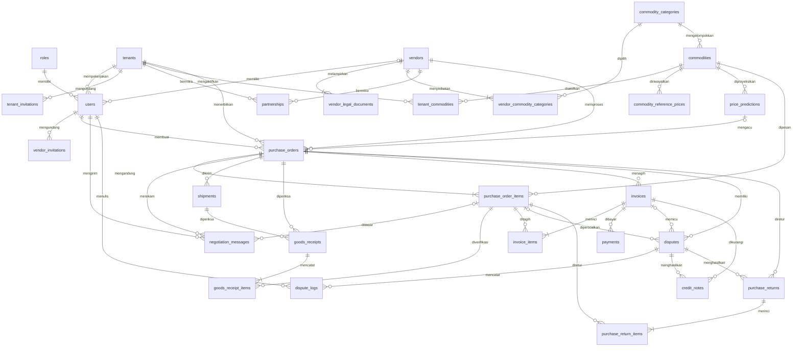

# PAGORA — Design Database

> Panduan skema untuk developer & AI agent: **membuat / mengubah migration, model, enum, factory, dan seeder** secara konsisten.
> Urutan sumber kebenaran: **`PRD.md`** (bisnis, model data target §8, status §9) → **dokumen ini** (detail skema) → `RULES.md` (cara menulis kode).
> Setiap perubahan tabel/kolom/seeder **wajib** dicatat di §11 (Changelog).
> Diperbarui 31 Oktober 2026, diselaraskan dengan PRD rev. 5.

---

## 0. Status Skema (BACA INI)

- Dokumen ini menjelaskan **skema target** (Bahasa Inggris, PRD §8). Database saat ini **masih memakai nama Indonesia** dari ERD (`perusahaan_buyer`, `po_item`, `sengketa`, dst.).
- Semua migration yang ada **sudah masuk `main`**. Jangan mengeditnya. Perpindahan ke skema target dilakukan lewat **migration baru** (rename tabel/kolom, tambah tabel/kolom) sesuai §5.
- Setiap tabel di §4 mencantumkan **nama saat ini** agar agent bisa memetakan kode lama.
- Tanda **⚠️** = belum final; konfirmasi ke tim sebelum dibangun. Tanda **[baru]** = tabel/kolom yang belum ada di database.

## 1. Konvensi Wajib

| Hal | Aturan |
|---|---|
| DBMS | PostgreSQL |
| Bahasa | Nama tabel, kolom, nilai enum: **Bahasa Inggris** (PRD Q-26). Pengecualian: nilai `roles.name` `manajemen` & `qc_gudang` tetap (PRD Q-27) |
| Nama tabel | Plural `snake_case` (`purchase_orders`, `credit_notes`); pivot memakai dua nama berurutan (`vendor_commodity_categories`) |
| Nama class Model | **Tetap** nama domain yang sudah ada (`Komoditas`, `KerjaSama`, `Sengketa`); class untuk tabel **[baru]** memakai **Bahasa Inggris** (`CreditNote`, `Payment`, `PurchaseReturn`, …). Bila nama class ≠ nama tabel, Model **wajib** `protected $table` (RULES §11.1) |
| PK | `id` (`bigIncrements`), internal saja |
| Identifier publik | `uuid` (`uuid()->unique()`) di setiap tabel entitas; `slug` bila perlu URL terbaca |
| FK | `{singular}_id`, `foreignId()->constrained('<tabel>')`; `onDelete` eksplisit, default **`restrictOnDelete()`** |
| FK ke user dengan peran | Nama kolom menjelaskan peran: `created_by`, `verified_by`, `inspected_by`, `blocked_by`, `opened_by`, `resolved_by` |
| Uang | `decimal(15, 2)`; total/subtotal `decimal(17, 2)`; cast `decimal:2` |
| Kuantitas | `decimal(15, 3)` |
| Persentase | `decimal(5, 2)` (0–100) |
| Status | `string(30)` + **PHP Backed Enum** di `app/Enums` (nilai Inggris, `label()` Indonesia). Dilarang `enum()` DB |
| Boolean status | Prefix `is_` (`is_active`) |
| Waktu kejadian | Suffix `_at` (`verified_at`, `blocked_at`); tanggal bisnis suffix `_date` (`po_date`, `invoice_date`) |
| Timestamp | `timestamps()` kecuali tabel immutable (hanya `created_at`, §7) |
| Soft delete | Hanya data master & draf: `users`, `tenants`, `vendors`, `commodities`, `commodity_categories`, `purchase_orders` (untuk draf), `vendor_invitations`. Data transaksi tidak pernah dihapus |
| File | Simpan **path** (`string(500)`) atau `json` untuk banyak file. Berkas legalitas & bukti di disk privat (`storage/app/private`) |
| Index | Semua FK, kolom `status`, kolom yang sering difilter/diurutkan |
| Migration | `YYYY_MM_DD_HHMMSS_<aksi>_<tabel>_table`; satu tabel per file untuk `create`; wajib `down()` yang membalikkan |

## 2. Daftar Tabel

| # | Tabel target | Nama saat ini | Model | Ringkas |
|---|---|---|---|---|
| 1 | `roles` | `role` | `Role` | 6 role RBAC |
| 2 | `users` | `users` | `User` | Akun semua role |
| 3 | `tenants` | `perusahaan_buyer` | `PerusahaanBuyer` | Perusahaan pembeli |
| 4 | `vendors` | `vendor` | `Vendor` | Perusahaan pemasok |
| 5 | `vendor_legal_documents` | `dokumen_legalitas_vendor` | `DokumenLegalitasVendor` | NPWP/SIUP vendor |
| 6 | `vendor_commodity_categories` | — [baru] | — (pivot) | Vendor ↔ kategori (M:N) |
| 7 | `vendor_invitations` | `undangan_vendor` | `UndanganVendor` | Undangan registrasi vendor |
| 8 | `tenant_invitations` | — [baru] | `TenantInvitation` | Undangan staf internal (UC-03) |
| 9 | `partnerships` | `kerja_sama` | `KerjaSama` | Kemitraan Tenant ↔ Vendor |
| 10 | `commodity_categories` | — [baru] | `CommodityCategory` | Kategori global |
| 11 | `commodities` | `komoditas` | `Komoditas` | Master komoditas global |
| 12 | `tenant_commodities` | — [baru] | `TenantCommodity` | Aktivasi & toleransi susut per Tenant |
| 13 | `commodity_reference_prices` | `harga_referensi_komoditas` | `HargaReferensiKomoditas` | Riwayat harga API BI |
| 14 | `price_predictions` | `prediksi_harga` | `PrediksiHarga` | Hasil regresi + Harga Pagu |
| 15 | `purchase_orders` | `purchase_order` | `PurchaseOrder` | Header PO |
| 16 | `purchase_order_items` | `po_item` | `PoItem` | Item PO |
| 17 | `negotiation_messages` | `chat_negosiasi` | `ChatNegosiasi` | Pesan & tawaran (immutable) |
| 18 | `shipments` | `pengiriman` | `Pengiriman` | Laporan pengiriman vendor |
| 19 | `goods_receipts` | `penerimaan_barang` | `PenerimaanBarang` | Header inspeksi QC |
| 20 | `goods_receipt_items` | `penerimaan_barang_item` | `PenerimaanBarangItem` | Hasil inspeksi per item |
| 21 | `invoices` | `invoice` | `Invoice` | Tagihan vendor |
| 22 | `invoice_items` | — [baru] | `InvoiceItem` | Rincian tagihan per item |
| 23 | `payments` | — [baru] | `Payment` | Pembayaran (invoice 1:N) |
| 24 | `disputes` | `sengketa` | `Sengketa` | Sengketa |
| 25 | `dispute_logs` | `log_sengketa` | `LogSengketa` | Log sengketa (immutable) |
| 26 | `credit_notes` | — [baru] | `CreditNote` | Potongan tagihan |
| 27 | `purchase_returns` | — [baru] | `PurchaseReturn` | Dokumen retur |
| 28 | `purchase_return_items` | — [baru] | `PurchaseReturnItem` | Item retur |
| 29 | `settings` | `pengaturan` | (cek model eksisting) | Konfigurasi sistem key-value (di luar PRD, sudah dipakai) |

Tabel bawaan Laravel/Fortify (`password_reset_tokens`, `sessions`, `cache`, `jobs`, `passkeys`) tidak diubah.
Class model untuk tabel **[baru]** memakai Bahasa Inggris (keputusan §12 no. 6); class lama (`Komoditas`, `UndanganVendor`, dst.) tidak diganti namanya.

## 3. Diagram Relasi



## 4. Definisi Tabel

Notasi: `FK→tabel`, `NN` = not null, `U` = unique, `idx` = index. Semua tabel entitas punya `id` (PK) + `uuid` (U NN); tidak ditulis ulang.
Kolom `timestamps` tidak ditulis ulang kecuali tabel immutable. Kolom "Saat ini" kosong = sama atau baru.

### 4.1 `roles` (saat ini `role`)
| Kolom | Tipe | Saat ini | Catatan |
|---|---|---|---|
| name | string(50) U NN | `nama_role` | `superadmin`, `owner`, `manajemen`, `purchasing`, `qc_gudang`, `vendor` |
| description | text null | `deskripsi` | |

`id` tetap: 1 superadmin, 2 purchasing (sebelumnya `buyer`), 3 qc_gudang, 4 vendor, 5 manajemen, 6 owner. Tabel ini **tidak** punya `uuid`.

### 4.2 `users` (softDeletes)
| Kolom | Tipe | Saat ini | Catatan |
|---|---|---|---|
| name | string(150) NN | `nama_lengkap` | |
| email | string(150) U NN | | |
| email_verified_at | timestamp null | | |
| password | string null | | null untuk akun Google-only |
| google_id | string U null | | Socialite |
| avatar | string(500) null | | |
| role_id | FK→roles NN, idx | | |
| tenant_id | FK→tenants null, idx | `perusahaan_id` | Untuk owner, manajemen, purchasing, qc_gudang |
| vendor_id | FK→vendors null, idx | | Untuk role vendor |
| is_active | boolean NN default true | `status_aktif` | Nonaktif = tidak bisa login |
| two_factor_* | | | Kolom Fortify, tidak diubah |
| remember_token | | | Ingat Saya maks 30 hari (konfigurasi, bukan kolom) |

Aturan (di Service/Form Request): role `vendor` ⇒ `vendor_id` terisi & `tenant_id` null; role Tenant ⇒ `tenant_id` terisi & `vendor_id` null; `superadmin` ⇒ keduanya null.

### 4.3 `tenants` (saat ini `perusahaan_buyer`, softDeletes)
| Kolom | Tipe | Saat ini | Catatan |
|---|---|---|---|
| company_name | string(200) NN | `nama_perusahaan` | |
| tax_number | string(30) null | `nomor_npwp` | NPWP |
| legal_document_path | string(500) null | `file_url` | |
| address | text null | `alamat` | |
| verification_status | string(30) NN default `pending`, idx | [baru] | `pending`, `approved`, `rejected` |
| verification_note | text null | [baru] | Alasan penolakan |
| verified_by | FK→users null | [baru] | Superadmin |
| verified_at | timestamp null | [baru] | |
| is_active | boolean NN default true | `status_aktif` | |
| ~~tipe_paket~~ | | `tipe_paket` | **Dihapus** (langganan di luar cakupan, PRD Q-18) |

### 4.4 `vendors` (saat ini `vendor`, softDeletes)
| Kolom | Tipe | Saat ini | Catatan |
|---|---|---|---|
| slug | string(160) U NN | | |
| company_name | string(200) NN | `nama_perusahaan` | |
| tax_number | string(30) null | [baru] | NPWP (wajib di form registrasi baru) |
| contact_email | string(150) U NN | `email_kontak` | |
| phone | string(30) null | `no_telepon` | |
| address | text null | `alamat` | |
| verification_status | string(30) NN default `pending`, idx | `status_verifikasi` | `pending`, `approved`, `rejected` |
| is_active | boolean NN default true | `status_aktif` | `false` = **blokir global** (Superadmin) |
| block_reason | text null | `alasan_pemblokiran` | |
| blocked_by | FK→users null | | |
| blocked_at | timestamp null | `diblokir_pada` | |
| ~~kategori_komoditas~~ | | `kategori_komoditas` | Dipindah ke `vendor_commodity_categories`, lalu dihapus |
| ~~dokumen_legalitas~~ | | `dokumen_legalitas` | Duplikat `vendor_legal_documents`: (1) migration data memindahkan isinya ke `vendor_legal_documents`, (2) verifikasi jumlah & isi hasil pindahan, (3) baru hapus kolom di **migration terpisah** |

### 4.5 `vendor_legal_documents` (saat ini `dokumen_legalitas_vendor`)
| Kolom | Tipe | Saat ini | Catatan |
|---|---|---|---|
| vendor_id | FK→vendors NN, idx | | |
| document_type | string(50) NN | `jenis_dokumen` | `npwp`, `siup`, `nib` |
| document_number | string(100) null | `nomor_dokumen` | |
| file_path | string(500) NN | `file_url` | Disk privat |
| verification_status | string(30) NN default `pending` | `status_verifikasi` | `pending`, `approved`, `rejected` |
| rejection_reason | text null | `alasan_penolakan` | |
| verified_by | FK→users null | `verif_by` | Superadmin |
| verified_at | timestamp null | `diverifikasi_pada` | |

### 4.6 `vendor_commodity_categories` [baru]
| Kolom | Tipe | Catatan |
|---|---|---|
| vendor_id | FK→vendors NN, cascadeOnDelete | |
| commodity_category_id | FK→commodity_categories NN, restrictOnDelete | |

Primary/unique: (`vendor_id`, `commodity_category_id`). Tanpa `uuid` (pivot murni). Minimal 1 baris per vendor (validasi di Service).

### 4.7 `vendor_invitations` (saat ini `undangan_vendor`, softDeletes)
| Kolom | Tipe | Saat ini | Catatan |
|---|---|---|---|
| company_name | string(200) NN | `nama_perusahaan` | |
| email | string(150) NN, idx | | |
| commodity_category_id | FK→commodity_categories null | `kategori_komoditas` (string) | |
| message | text null | `pesan` | |
| token | string(64) U NN | | Acak, sekali pakai |
| status | string(30) NN default `pending`, idx | | `pending`, `accepted`, `expired`, `cancelled` (lihat catatan) |
| invited_by | FK→users NN | | Owner/Manajemen |
| tenant_id | FK→tenants null | [baru] | Tenant pengundang (bila diundang dari Tenant) |
| expires_at | timestamp null | | Saat ini 7 hari (`VendorService`) |
| registered_at | timestamp null | | Diisi saat status menjadi `accepted` |

Catatan status (keputusan §12 no. 4, disesuaikan dengan kode saat ini):
- Kode sekarang hanya memakai `pending` dan `terdaftar` (`VendorRegistrationService`) → migration data `terdaftar` → `accepted`.
- `expired` saat ini hanya dihitung dari `expires_at` (`UndanganVendor::isExpired()`); Service menyimpan `expired` saat undangan `pending` diakses setelah `expires_at`. `isValid()` tetap memeriksa `expires_at`.
- `cancelled`: undangan `pending` dibatalkan pengundang. Aksi batal belum ada di kode.

### 4.8 `tenant_invitations` [baru]
Undangan email staf internal (PRD UC-03, FR-03). Disetujui (keputusan §12 no. 3). Model `TenantInvitation`.

| Kolom | Tipe | Catatan |
|---|---|---|
| tenant_id | FK→tenants NN | |
| email | string(150) NN, idx | |
| role_id | FK→roles NN | Hanya `manajemen`, `purchasing`, `qc_gudang` |
| token | string(64) U NN | |
| status | string(30) NN default `pending` | `pending`, `accepted`, `declined`, `expired` |
| invited_by | FK→users NN | Owner |
| expires_at | timestamp null | |
| responded_at | timestamp null | |

### 4.9 `partnerships` (saat ini `kerja_sama`)
| Kolom | Tipe | Saat ini | Catatan |
|---|---|---|---|
| tenant_id | FK→tenants NN | `id_perusahaan` | |
| vendor_id | FK→vendors NN | `id_vendor` | |
| requested_by | string(20) NN | [baru] | `tenant` / `vendor` (pihak pengaju, untuk tab "Undangan Masuk") |
| status | string(30) NN default `pending`, idx | `status_kerjasama` | `pending`, `agreed`, `rejected`, `cancelled`, `blocked` |
| rejection_reason | text null | `catatan_penolakan` | |
| block_reason | text null | [baru] | Blokir per Tenant |
| blocked_by | FK→users null | [baru] | Owner/Manajemen |
| blocked_at | timestamp null | [baru] | |

Unique: (`tenant_id`, `vendor_id`). Pengajuan ulang setelah `rejected`/`cancelled` memperbarui baris yang sama ⚠️.

### 4.10 `commodity_categories` [baru] (softDeletes)
| Kolom | Tipe | Catatan |
|---|---|---|
| name | string(100) U NN | Diisi dari nilai `komoditas.kategori` yang ada |
| description | text null | |
| is_active | boolean NN default true | |

### 4.11 `commodities` (saat ini `komoditas`, softDeletes)
| Kolom | Tipe | Saat ini | Catatan |
|---|---|---|---|
| sku | string(50) U null | | |
| slug | string(160) U NN | | |
| name | string(150) U NN | `nama_komoditas` | |
| commodity_category_id | FK→commodity_categories null, idx | `kategori` (string) | Wajib untuk data baru |
| unit | string(20) NN | `satuan` | `kg`, `liter`, `butir`, dst. |
| default_shrinkage_tolerance | decimal(5,2) NN default 0 | `batas_susut` | Persen |
| api_reference_code | string(50) null | `kode_referensi_api` | Kode komoditas API BI |
| specification | text null | `spesifikasi` | |
| is_active | boolean NN default true | `status` | |

Dikelola Superadmin (global).

### 4.12 `tenant_commodities` [baru]
| Kolom | Tipe | Catatan |
|---|---|---|
| tenant_id | FK→tenants NN | |
| commodity_id | FK→commodities NN | |
| is_active | boolean NN default true | |
| shrinkage_tolerance | decimal(5,2) null | Null = pakai `commodities.default_shrinkage_tolerance` |

Unique: (`tenant_id`, `commodity_id`).

### 4.13 `commodity_reference_prices` (saat ini `harga_referensi_komoditas`)
| Kolom | Tipe | Saat ini | Catatan |
|---|---|---|---|
| commodity_id | FK→commodities NN | `komoditas_id` | |
| date | date NN | `tanggal` | |
| price | decimal(15,2) NN | `harga` | Per satuan |
| source | string(100) null | `sumber_data` | `bank_indonesia` / `seeder` |
| created_at | timestamp | | |

Unique: (`commodity_id`, `date`, `source`). Index: (`commodity_id`, `date`).

### 4.14 `price_predictions` (saat ini `prediksi_harga`)
| Kolom | Tipe | Saat ini | Catatan |
|---|---|---|---|
| commodity_id | FK→commodities NN | `komoditas_id` | |
| prediction_date | date NN | `tanggal_prediksi` | Periode yang diprediksi |
| predicted_price | decimal(15,2) NN | `harga_prediksi` | |
| recommended_ceiling_price | decimal(15,2) NN | `harga_pagu_rekomendasi` | **Harga Pagu** |
| calculated_at | timestamp NN | `dihitung_pada` | |

Index: (`commodity_id`, `prediction_date`). Rumus Harga Pagu di satu Service; sementara `predicted_price × 1.05` (§8.5).

### 4.15 `purchase_orders` (saat ini `purchase_order`, softDeletes untuk draf)
| Kolom | Tipe | Saat ini | Catatan |
|---|---|---|---|
| po_number | string(50) U NN | `nomor_po` | `PO-2026-0001` |
| tenant_id | FK→tenants NN, idx | `perusahaan_buyer_id` | |
| vendor_id | FK→vendors NN, idx | | Wajib mitra `agreed` (BR-03) |
| created_by | FK→users NN | | |
| price_prediction_id | FK→price_predictions null | `prediksi_harga_id` | |
| ceiling_price_reference | decimal(15,2) null | `harga_pagu_acuan` | Snapshot Harga Pagu; **tidak dikirim ke Vendor** |
| status | string(30) NN default `draft`, idx | | Enum §6 |
| po_date | date NN | `tanggal_po` | |
| notes | text null | `catatan` | |
| locked_at | timestamp null | [baru] | Diisi saat `agreed` |

Soft delete hanya untuk PO `draft` (hapus draf, UC-12).

### 4.16 `purchase_order_items` (saat ini `po_item`)
| Kolom | Tipe | Saat ini | Catatan |
|---|---|---|---|
| purchase_order_id | FK→purchase_orders NN, idx | | |
| commodity_id | FK→commodities NN | `komoditas_id` | |
| quantity | decimal(15,3) NN | `jumlah_pesanan` | |
| estimated_unit_price | decimal(15,2) NN | [baru] | Estimasi anggaran; **tidak dikirim ke Vendor** |
| vendor_offer_price | decimal(15,2) null | `harga_tawar_vendor` | Tawaran terakhir Vendor |
| unit_price | decimal(15,2) null | `harga_satuan_po` (NN) | Harga final saat `agreed`; ubah ke nullable |
| subtotal | decimal(17,2) null | | `quantity × unit_price` |
| negotiation_status | string(30) NN default `pending`, idx | `status_item` | `pending`, `countered`, `agreed`, `removed` |

### 4.17 `negotiation_messages` (saat ini `chat_negosiasi`, **immutable**)
| Kolom | Tipe | Saat ini | Catatan |
|---|---|---|---|
| purchase_order_id | FK→purchase_orders NN, idx | | |
| purchase_order_item_id | FK→purchase_order_items null | [baru] | Tawaran per item |
| sender_id | FK→users NN | `pengirim_id` | |
| type | string(30) NN default `text` | [baru] | `text`, `offer`, `acceptance`, `item_removed`, `system` |
| message | text null | `pesan_teks` | |
| offer_amount | decimal(15,2) null | `nominal_tawar` | |
| created_at | timestamp NN | | |

### 4.18 `shipments` (saat ini `pengiriman`)
| Kolom | Tipe | Saat ini | Catatan |
|---|---|---|---|
| purchase_order_id | FK→purchase_orders NN, idx | | 1 PO : N (pengiriman ulang) |
| dispute_id | FK→disputes null | [baru] | Diisi bila pengiriman ulang hasil sengketa |
| route | string(50) NN | `jalur_pengiriman` | |
| carrier_name | string(150) NN | `nama_armada_ekspedisi` | |
| vehicle_plate_number | string(20) NN | `no_polisi_armada` | |
| estimated_arrival_date | date NN | `perkiraan_tanggal_tiba` | ETA |
| status | string(30) NN default `in_transit` | | `in_transit`, `arrived` |
| reported_by | FK→users NN | `dilaporkan_oleh` | Vendor |
| created_at | timestamp | | Tambah `updated_at` untuk status `arrived` |

### 4.19 `goods_receipts` (saat ini `penerimaan_barang`)
| Kolom | Tipe | Saat ini | Catatan |
|---|---|---|---|
| purchase_order_id | FK→purchase_orders NN, idx | | |
| shipment_id | FK→shipments NN | [baru] | |
| inspected_by | FK→users NN | `check_by` | QC Gudang |
| matched_plate_number | string(20) null | `no_polisi_dicocokkan` | |
| inspected_at | timestamp NN | `tanggal_pemeriksaan` | |
| notes | text null | `catatan` | |
| created_at | timestamp | | |

### 4.20 `goods_receipt_items` (saat ini `penerimaan_barang_item`)
| Kolom | Tipe | Saat ini | Catatan |
|---|---|---|---|
| goods_receipt_id | FK→goods_receipts NN | `penerimaan_barang_id` | |
| purchase_order_item_id | FK→purchase_order_items NN, idx | `po_item_id` | |
| received_quantity | decimal(15,3) NN | `jumlah_diterima` | |
| status | string(30) NN | | `accepted`, `rejected` |
| notes | text null | `catatan` | Wajib bila `rejected` |
| rejection_photos | json null | `foto_bukti_penolakan` (string) | Array path; **≥ 1 bila `rejected`**, ≤ 5 MB/berkas; immutable |
| created_at | timestamp | | |

### 4.21 `invoices` (saat ini `invoice`)
| Kolom | Tipe | Saat ini | Catatan |
|---|---|---|---|
| purchase_order_id | FK→purchase_orders NN, idx | | 1 PO : N invoice |
| vendor_id | FK→vendors NN, idx | [baru] | Disalin dari `purchase_orders.vendor_id` oleh Service (wajib sama); untuk unique per vendor |
| vendor_invoice_number | string(100) NN | `nomor_invoice_vendor` | **UNIQUE (`vendor_id`, `vendor_invoice_number`)** |
| total_amount | decimal(17,2) NN | `jumlah_tagihan` | Σ `invoice_items.subtotal` |
| file_path | string(500) null | `file_invoice` | |
| invoice_date | date NN | `tanggal_invoice` | |
| matching_status | string(30) NN default `pending`, idx | `status_matching` | `pending`, `matched`, `mismatched` |
| matching_result | json null | [baru] | Detail per item (qty PO / diterima / ditagih, harga) |
| verified_by | FK→users null | `diverifikasi_oleh` | Purchasing/Owner |
| verified_at | timestamp null | `diverifikasi_pada` | |

### 4.22 `invoice_items` [baru]
| Kolom | Tipe | Catatan |
|---|---|---|
| invoice_id | FK→invoices NN | |
| purchase_order_item_id | FK→purchase_order_items NN | Hanya item `accepted` yang belum ditagih |
| quantity | decimal(15,3) NN | |
| unit_price | decimal(15,2) NN | Salinan `purchase_order_items.unit_price` |
| subtotal | decimal(17,2) NN | |

### 4.23 `payments` [baru]
| Kolom | Tipe | Catatan |
|---|---|---|
| invoice_id | FK→invoices NN, idx | 1 invoice : N payments |
| payment_number | string(50) U NN | |
| payment_date | timestamp null | Diisi saat berhasil |
| amount | decimal(17,2) NN | |
| payment_method | string(50) null | Dari gateway |
| payment_status | string(30) NN default `pending`, idx | `pending`, `paid`, `failed` |
| reference_number | string(100) null, idx | Ref. gateway (Midtrans/Xendit) |
| proof_file | string(500) null | |
| created_by | FK→users NN | |

### 4.24 `disputes` (saat ini `sengketa`)
| Kolom | Tipe | Saat ini | Catatan |
|---|---|---|---|
| purchase_order_id | FK→purchase_orders NN, idx | [baru] | |
| purchase_order_item_id | FK→purchase_order_items null | [baru] | Sengketa per item (QC) |
| invoice_id | FK→invoices null | | Sengketa 3-Way Matching |
| trigger_type | string(30) NN | [baru] | `goods_mismatch`, `qc_rejected`, `quantity_mismatch`, `amount_mismatch`, `settlement_disagreement` |
| reason | text NN | [baru] | |
| opened_by | FK→users null | `dibuka_oleh` (NN) | Null = dibuka otomatis oleh sistem |
| status | string(30) NN default `open`, idx | | `open`, `awaiting_response`, `in_mediation`, `resolved` |
| resolution_type | string(30) null | [baru] | `reshipment`, `return`, `credit_note` |
| resolution_notes | text null | [baru] | |
| vendor_confirmed_by | FK→users null | [baru] | |
| vendor_confirmed_at | timestamp null | [baru] | Wajib sebelum `resolved` bila penyelesaian butuh Vendor |
| resolved_by | FK→users null | [baru] | Hanya Owner/Manajemen |
| opened_at | timestamp NN | `tanggal_dibuka` | |
| resolved_at | timestamp null | `tanggal_selesai` | |

Setelah `resolved`, baris tidak boleh diubah (dijaga Service + trigger §7).

### 4.25 `dispute_logs` (saat ini `log_sengketa`, **immutable**)
| Kolom | Tipe | Saat ini | Catatan |
|---|---|---|---|
| dispute_id | FK→disputes NN, idx | `sengketa_id` | |
| user_id | FK→users null | (NN) | Null = sistem |
| type | string(30) NN | [baru] | `note`, `status_change`, `evidence`, `chat_snapshot`, `resolution` |
| message | text null | `isi_pesan` | |
| attachment_path | string(500) null | `file_bukti` | |
| created_at | timestamp NN | | |

### 4.26 `credit_notes` [baru]
| Kolom | Tipe | Catatan |
|---|---|---|
| credit_note_number | string(50) U NN | |
| invoice_id | FK→invoices NN, idx | |
| dispute_id | FK→disputes NN, idx | Satu sengketa dapat > 1 credit note |
| credit_date | date NN | |
| amount | decimal(17,2) NN | Total credit note `confirmed` ≤ `invoices.total_amount` |
| reason | text NN | |
| status | string(30) NN default `draft` | `draft`, `awaiting_vendor_confirmation`, `confirmed`, `rejected` |
| vendor_confirmed_by | FK→users null | |
| vendor_confirmed_at | timestamp null | |
| created_by | FK→users NN | Owner/Manajemen |

### 4.27 `purchase_returns` [baru]
| Kolom | Tipe | Catatan |
|---|---|---|
| return_number | string(50) U NN | |
| purchase_order_id | FK→purchase_orders NN, idx | |
| dispute_id | FK→disputes NN, idx | |
| return_date | date NN | |
| reason | text NN | |
| status | string(30) NN default `draft` | `draft`, `awaiting_vendor_confirmation`, `confirmed`, `rejected`, `completed` |
| vendor_confirmed_by | FK→users null | |
| vendor_confirmed_at | timestamp null | |
| created_by | FK→users NN | |

### 4.28 `purchase_return_items` [baru]
| Kolom | Tipe | Catatan |
|---|---|---|
| purchase_return_id | FK→purchase_returns NN | |
| purchase_order_item_id | FK→purchase_order_items NN | |
| goods_receipt_item_id | FK→goods_receipt_items NN | Item yang ditolak QC |
| quantity | decimal(15,3) NN | ≤ kuantitas ditolak |
| notes | text null | |

### 4.29 `settings` (saat ini `pengaturan`)
| Kolom | Tipe | Saat ini | Catatan |
|---|---|---|---|
| group | string(50) NN, idx | `grup` | |
| key | string(100) U NN | `kunci` | |
| value | text null | `nilai` | |
| is_encrypted | boolean NN default false | `terenkripsi` | Kunci API/secret |
| updated_by | FK→users null, nullOnDelete | `diubah_oleh` | |

Kredensial produksi tetap di `.env` (NFR-06); tabel ini hanya untuk konfigurasi yang boleh diubah dari UI.

## 5. Strategi Migrasi ke Skema Target

Karena migration lama sudah di `main`, refactor dilakukan **per modul** dengan migration baru. Setiap langkah harus membuat aplikasi tetap berjalan dan test lulus.

**Pola per modul**
1. Migration rename: `Schema::rename('komoditas', 'commodities')` lalu `$table->renameColumn('nama_komoditas', 'name')` (satu file per tabel, `down()` membalikkan).
2. Migration tambah/ubah kolom & tabel baru modul tsb (data lama dipindahkan di migration yang sama atau migration data terpisah).
3. Perbarui Model (`$table`, `$fillable`, `casts()`, relasi), Enum, Factory, Seeder, Repository, Resource (key Inggris), Form Request, frontend props, dan test **dalam PR yang sama**.
4. `php artisan migrate:fresh --seed` dan `php artisan test --compact` lulus.
5. Catat di §11.

**Urutan modul (mengikuti ketergantungan FK)**
1. `roles` (+ ubah `buyer` → `purchasing`), `users`
2. `tenants`, `vendors`, `vendor_legal_documents`, `vendor_invitations`, `settings`
3. `commodity_categories` [baru] → `commodities` (pindahkan `kategori` string ke FK) → `tenant_commodities` [baru], `vendor_commodity_categories` [baru]
4. `partnerships`
5. `commodity_reference_prices`, `price_predictions`
6. `purchase_orders`, `purchase_order_items`, `negotiation_messages`
7. `shipments`, `goods_receipts`, `goods_receipt_items`
8. `invoices`, `invoice_items` [baru], `payments` [baru]
9. `disputes`, `dispute_logs`, `credit_notes` [baru], `purchase_returns` [baru], `purchase_return_items` [baru]
10. `tenant_invitations` [baru]

**Perubahan nilai enum** dilakukan di migration data (`UPDATE ... SET status = 'negotiation' WHERE status = 'negosiasi'`) bersamaan dengan perubahan Enum PHP.

## 6. Status & Enum

Nilai lengkap + label UI ada di **PRD §9**. Ringkasan untuk skema:

| Enum (class saat ini → nilai target) | Kolom | Nilai target | Nilai saat ini |
|---|---|---|---|
| `StatusPurchaseOrder` | `purchase_orders.status` | `draft`, `negotiation`, `agreed`, `in_transit`, `partially_received`, `received`, `invoiced`, `ready_to_pay`, `paid`, `completed`, `cancelled` | `draft`, `menunggu_tanggapan`*, `negosiasi`, `disepakati`, `dalam_pengiriman`, `diterima_gudang`, `ditagih`, `lunas`, `dibatalkan`, `sengketa`* |
| `StatusKerjaSama` | `partnerships.status` | `pending`, `agreed`, `rejected`, `cancelled`, `blocked` | `diajukan`, `aktif`, `ditolak`, `berakhir` |
| `StatusSengketa` | `disputes.status` | `open`, `awaiting_response`, `in_mediation`, `resolved` | `terbuka`, `dalam_mediasi`, `selesai` |
| `StatusUndanganVendor` [baru] | `vendor_invitations.status` | `pending`, `accepted`, `expired`, `cancelled` | `pending`, `terdaftar` (string tanpa Enum) |
| `StatusTenantInvitation` [baru] | `tenant_invitations.status` | `pending`, `accepted`, `declined`, `expired` | — (tabel baru) |
| [baru] | `purchase_order_items.negotiation_status` | `pending`, `countered`, `agreed`, `removed` | `menunggu` |
| [baru] | `goods_receipt_items.status` | `accepted`, `rejected` | (string bebas) |
| [baru] | `invoices.matching_status` | `pending`, `matched`, `mismatched` | `pending` |
| [baru] | `payments.payment_status` | `pending`, `paid`, `failed` | — |
| [baru] | `credit_notes.status` | `draft`, `awaiting_vendor_confirmation`, `confirmed`, `rejected` | — |
| [baru] | `purchase_returns.status` | `draft`, `awaiting_vendor_confirmation`, `confirmed`, `rejected`, `completed` | — |
| [baru] | `disputes.trigger_type` | `goods_mismatch`, `qc_rejected`, `quantity_mismatch`, `amount_mismatch`, `settlement_disagreement` | — |
| [baru] | `disputes.resolution_type` | `reshipment`, `return`, `credit_note` | — |
| [baru] | `tenants/vendors/vendor_legal_documents.verification_status` | `pending`, `approved`, `rejected` | `pending` |

\* Dihapus dari enum PO (PRD Q-15). Status PO dan status sengketa terpisah; PO "dibekukan" = punya sengketa yang belum `resolved`.

Transisi status hanya di **Service** (RULES §9.2). Diagram transisi: PRD §9.1 (PO) dan §9.3 (sengketa).

## 7. Immutability

Tabel/baris berikut tidak boleh di-UPDATE/DELETE (PRD BR-17):

| Objek | Jenis | Penjagaan |
|---|---|---|
| `negotiation_messages` | Seluruh tabel | Hanya `created_at`; Model `const UPDATED_AT = null`; Repository tanpa update/delete; trigger DB |
| `dispute_logs` | Seluruh tabel | Sama seperti di atas |
| `goods_receipt_items.rejection_photos` | Kolom | Service tidak pernah mengubah; file tidak dihapus dari storage |
| `disputes` berstatus `resolved` | Baris | Service menolak perubahan; trigger DB (cek `OLD.status = 'resolved'`) |
| `credit_notes`, `purchase_returns` berstatus `confirmed` | Baris | Service menolak perubahan (kecuali retur `confirmed` → `completed`) |
| Harga di `purchase_order_items` setelah PO `agreed` | Kolom | Service + Policy (PO terkunci) |

Trigger PostgreSQL untuk tabel immutable penuh, di migration terpisah:

```php
DB::unprepared(<<<'SQL'
CREATE OR REPLACE FUNCTION reject_update_delete() RETURNS trigger AS $$
BEGIN
  RAISE EXCEPTION 'Table % is immutable', TG_TABLE_NAME;
END;
$$ LANGUAGE plpgsql;

CREATE TRIGGER dispute_logs_immutable
BEFORE UPDATE OR DELETE ON dispute_logs
FOR EACH ROW EXECUTE FUNCTION reject_update_delete();
SQL);
```
- Ulangi untuk `negotiation_messages`. `down()` wajib `DROP TRIGGER` lalu `DROP FUNCTION` bila tidak dipakai tabel lain.
- Trigger dibuat **setelah** migration rename tabel terkait.
- Seeder hanya INSERT; `migrate:fresh` men-drop tabel sehingga aman.

## 8. Seeder

### 8.1 Prinsip
- **Idempotent**: `updateOrCreate`/`firstOrCreate` dengan kunci unik (`roles.id`, `commodities.sku`, `users.email`, `po_number`).
- **Deterministik**: tanpa `rand()` tanpa seed; tren harga memakai rumus tetap.
- **Reference seeder** (selalu jalan) vs **demo seeder** (hanya `local`/`testing`).
- Seeder tidak memanggil API BI atau payment gateway; harga dummy diberi `source = 'seeder'`.
- Akun demo memakai password dev `password` (di-hash). Jangan commit password asli.
- Transisi status pada data demo dibuat lewat nilai akhir yang **konsisten** (mis. PO `agreed` punya `locked_at`, semua item `agreed`, `unit_price` & `subtotal` terisi).

### 8.2 Urutan di `DatabaseSeeder`

| Urutan | Seeder (saat ini) | Jenis | Isi target |
|---|---|---|---|
| 1 | `RoleSeeder` | reference | 6 role; id 2 = `purchasing` |
| 2 | `CommodityCategorySeeder` [baru] ⚠️ | reference | Kategori dari `KomoditasSeeder` (Pangan Pokok, Bumbu & Rempah, …) |
| 3 | `KomoditasSeeder` | reference | ~10 komoditas global dengan `commodity_category_id` |
| 4 | `PerusahaanBuyerSeeder` | demo | 1 Tenant `approved` (+ 1 `pending` untuk uji verifikasi ⚠️) |
| 5 | `VendorSeeder` | demo | 3 vendor: 2 `approved`, 1 `pending`; + kategori komoditas |
| 6 | `UserSeeder` | demo | Akun §8.3 |
| 7 | `DokumenLegalitasVendorSeeder` | demo | NPWP + SIUP tiap vendor (path dummy) |
| 8 | `TenantCommoditySeeder` [baru] ⚠️ | demo | Aktivasi komoditas untuk Tenant demo |
| 9 | `KerjaSamaSeeder` | demo | 2 mitra `agreed`, 1 `pending`, 1 `blocked` |
| 10 | `HargaReferensiKomoditasSeeder` | demo | ±90 hari histori per komoditas |
| 11 | `PrediksiHargaSeeder` | demo | 1 prediksi terbaru per komoditas |
| 12 | `PurchaseOrderSeeder` | demo | Skenario §8.4 + item + pesan negosiasi |
| 13 | `PengirimanSeeder` | demo | Untuk PO ≥ `in_transit` (+ 1 pengiriman ulang) |
| 14 | `PenerimaanBarangSeeder` | demo | Item `accepted` + 1 item `rejected` berfoto |
| 15 | `InvoiceSeeder` | demo | Invoice + `invoice_items`; 1 `matched`, 1 `mismatched` |
| 16 | `PaymentSeeder` [baru] | demo | 1 `paid`, 1 `failed` |
| 17 | `SengketaSeeder` | demo | Sengketa per pemicu QC & matching + `dispute_logs`; 1 `resolved` dengan credit note, 1 dengan retur |

### 8.3 Akun demo (`UserSeeder`)

| Email | Role | Keterangan |
|---|---|---|
| `superadmin@pagora.test` | superadmin | Platform |
| `owner@pagora.test` | owner | Tenant demo |
| `manajemen@pagora.test` | manajemen | Tenant demo |
| `buyer@pagora.test` | purchasing | Tenant demo (email lama dipertahankan agar tidak memutus akun dev) ⚠️ |
| `qc@pagora.test` | qc_gudang | Tenant demo |
| `vendor1@pagora.test`, `vendor2@pagora.test` | vendor | Vendor `approved`, mitra `agreed` |
| `vendor3@pagora.test` | vendor | Vendor `pending` (uji verifikasi) |
| `blokir@pagora.test` | vendor | `is_active = false` (uji login ditolak) |

### 8.4 Skenario PO demo (`PurchaseOrderSeeder`)

Minimal satu PO per status: `draft`, `negotiation` (dengan pesan & 1 item `countered`), `agreed`, `in_transit`, `partially_received` (dengan sengketa item terbuka), `received`, `invoiced`, `ready_to_pay`, `paid`, `completed`, `cancelled` (termasuk 1 karena semua item `removed`). Setiap PO memiliki ≥ 2 item.

### 8.5 Harga Pagu di seeder
Gunakan Service yang sama dengan aplikasi. Rumus **sementara** (keputusan §12 no. 1): `recommended_ceiling_price = predicted_price × 1.05`. Margin 5% belum final dan perlu validasi, jadi simpan margin sebagai satu konstanta/konfigurasi di Service (bukan angka tersebar) dengan komentar `// TODO: validasi margin Harga Pagu`.

## 9. Prosedur Menambah/Mengubah Tabel atau Kolom

1. **Baca** PRD (FR/BR terkait) dan bagian tabel di dokumen ini.
2. **Cek kondisi nyata** repo: `database/migrations`, `app/Models`, `app/Enums`, `database/seeders`, `database/factories`. Bila berbeda dari dokumen ini, **laporkan selisihnya**; jangan menimpa diam-diam.
3. **Buat migration baru** (`php artisan make:migration ...`). Jangan edit migration yang sudah di `main`. Edit langsung hanya bila migration baru di branch sendiri dan belum di-push.
4. `down()` wajib membalikkan perubahan.
5. **Perbarui Model**: `$table`, `$fillable`, `casts()` (enum, json, decimal, date), relasi, `SoftDeletes` bila perlu.
6. **Perbarui Enum** di `app/Enums` dan migration data bila nilai berubah.
7. **Perbarui Factory & Seeder**; tetap idempotent dan urutan §8.2 utuh.
8. **Perbarui Policy / Repository / Service / Resource / Form Request / frontend** sesuai `RULES.md`.
9. **Verifikasi**: `php artisan migrate:fresh --seed`, `php artisan migrate:rollback` sekali, dan `php artisan test --compact`.
10. **Perbarui dokumen ini** (§2, §3, §4, §6, §8) dan tambahkan baris di **§11**. Bila mengubah model data, perbarui juga PRD §8.
11. Commit di branch `feat/...` format `feat : ...`, lalu Pull Request.

### Larangan
- Jangan hard delete data transaksi atau mengubah data immutable (§7).
- Jangan menambah tabel/kolom di luar PRD tanpa menandainya ⚠️ dan memberi tahu user.
- Jangan memakai `enum()` DB; gunakan string + PHP Enum.
- Jangan menaruh transisi status, 3-Way Matching, atau scoping Tenant di seeder/controller.
- Jangan menghapus kolom/tabel sebelum memeriksa seluruh FK dan pemakaian di kode.
- Jangan membuat nama tabel/kolom berbahasa Indonesia baru.

## 10. Aturan 3-Way Matching

Dijalankan per **invoice**, per **item** (`invoice_items`):

1. **PO**: `purchase_order_items.quantity` dan `unit_price` (harga terkunci).
2. **Gudang**: Σ `goods_receipt_items.received_quantity` berstatus `accepted` untuk item tsb, dikurangi kuantitas yang sudah ditagih invoice lain.
3. **Invoice**: `invoice_items.quantity`, `unit_price`, `subtotal`.

Cocok bila untuk setiap item: `invoice_items.quantity ≤ kuantitas diterima yang belum ditagih`, `invoice_items.unit_price = purchase_order_items.unit_price`, dan `invoices.total_amount = Σ invoice_items.subtotal`.

- Hasil detail disimpan di `invoices.matching_result` (JSON).
- Cocok → `matching_status = matched`, PO → `ready_to_pay`.
- Gagal → `matching_status = mismatched`, buat `disputes` (`trigger_type` = `quantity_mismatch` / `amount_mismatch`) + `dispute_logs` (`type = status_change`); **status PO tidak diubah** (PRD BR-14).
- Nominal yang dibayar = `total_amount` − Σ `credit_notes.amount` berstatus `confirmed` (BR-26).
- Toleransi selisih: **0** untuk tahap awal (keputusan §12 no. 2); selisih sekecil apa pun → `mismatched`.

## 11. Changelog Skema

| Tanggal | Perubahan | Oleh |
|---|---|---|
| 2026-10-21 | Draf awal 18 tabel dari ERD + SKPL | — |
| 2026-10-21 | Tambah role `owner` | — |
| 2026-10-21 | Migration diselaraskan ke ERD final (nama kolom Indonesia, `uuid` di semua tabel). `role.id`: 1 superadmin, 2 buyer, 3 qc_gudang, 4 vendor, 5 manajemen, 6 owner | — |
| 2026-10-27 | Tabel `pengaturan` (konfigurasi sistem) | — |
| 2026-10-30 | Tabel `undangan_vendor` | — |
| 2026-10-31 | **Dokumen diselaraskan ke PRD rev. 5** (skema target, belum dimigrasikan): penamaan Inggris; role `buyer` → `purchasing`; tabel baru `commodity_categories`, `tenant_commodities`, `vendor_commodity_categories`, `invoice_items`, `payments`, `credit_notes`, `purchase_returns`, `purchase_return_items`, `tenant_invitations` ⚠️; kolom baru di `tenants`, `vendors`, `partnerships`, `purchase_orders`, `purchase_order_items`, `negotiation_messages`, `shipments`, `goods_receipts`, `invoices`, `disputes`, `dispute_logs`; enum Inggris; hapus `tipe_paket`; strategi migrasi per modul (§5) | — |
| 2026-10-31 | Keputusan teknis §12: `tenant_invitations` disetujui; status `vendor_invitations` = `pending`/`accepted`/`expired`/`cancelled`; `invoices.vendor_id` [baru] + UNIQUE (`vendor_id`, `vendor_invoice_number`); prosedur hapus `vendors.dokumen_legalitas`; class baru berbahasa Inggris; Harga Pagu sementara × 1.05; toleransi matching 0; refactor bertahap per PR | — |

## 12. Keputusan Teknis (2026-10-31)

| No. | Hal | Keputusan |
|---|---|---|
| 1 | Rumus Harga Pagu | Sementara `predicted_price × 1.05`. Margin 5% **belum final** dan perlu validasi (§8.5) |
| 2 | Toleransi 3-Way Matching | **0** untuk tahap awal; selisih sekecil apa pun diperiksa (§10) |
| 3 | `tenant_invitations` | **Disetujui** untuk undangan staf UC-03 (§4.8) |
| 4 | Status `vendor_invitations` | `pending`, `accepted`, `expired`, `cancelled`, disesuaikan dengan kode yang ada (§4.7) |
| 5 | `vendors.dokumen_legalitas` | Pindahkan data ke `vendor_legal_documents`, verifikasi, lalu hapus kolom lama (§4.4) |
| 6 | Nama class tabel baru | **Bahasa Inggris**: `CreditNote`, `Payment`, `PurchaseReturn`, dst. (§1, §2) |
| 7 | Nomor invoice vendor | Unik per vendor: **UNIQUE (`vendor_id`, `vendor_invoice_number`)**; `invoices.vendor_id` ditambahkan (§4.21) |
| 8 | Strategi refactor | **Bertahap, satu modul per PR** sesuai urutan §5 |

Tidak ada pertanyaan teknis yang terbuka. Yang masih perlu ditindaklanjuti: validasi margin Harga Pagu (no. 1).
